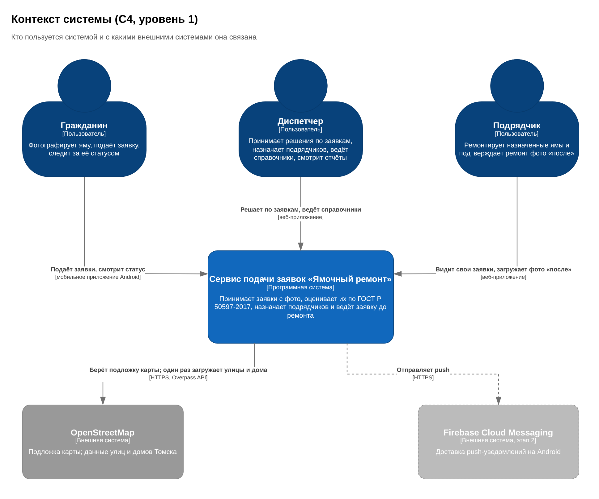
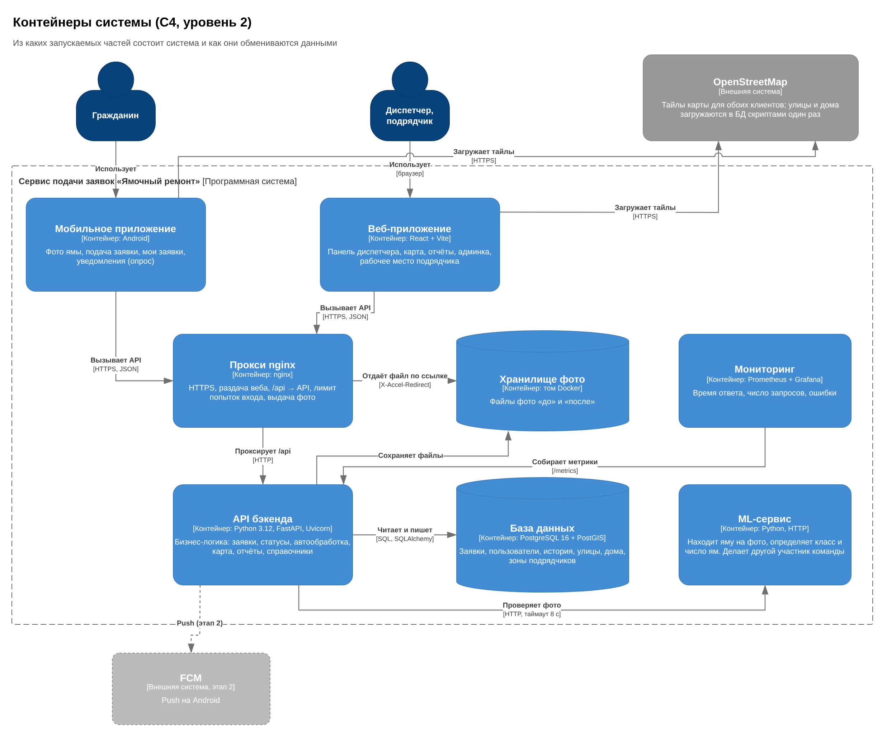
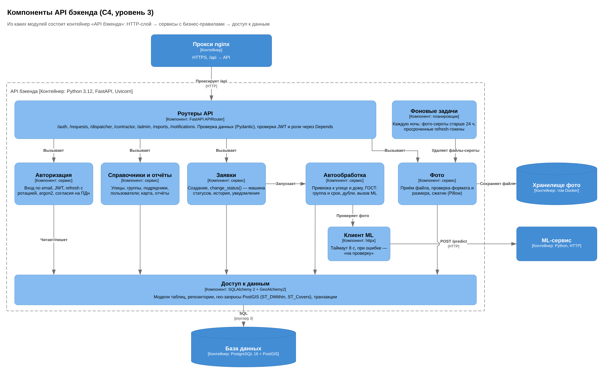
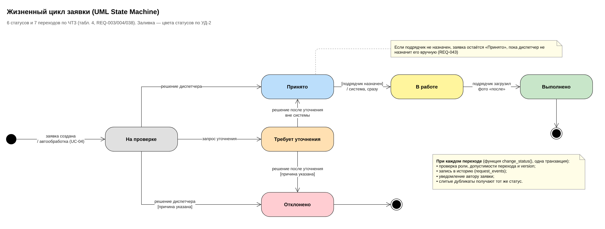
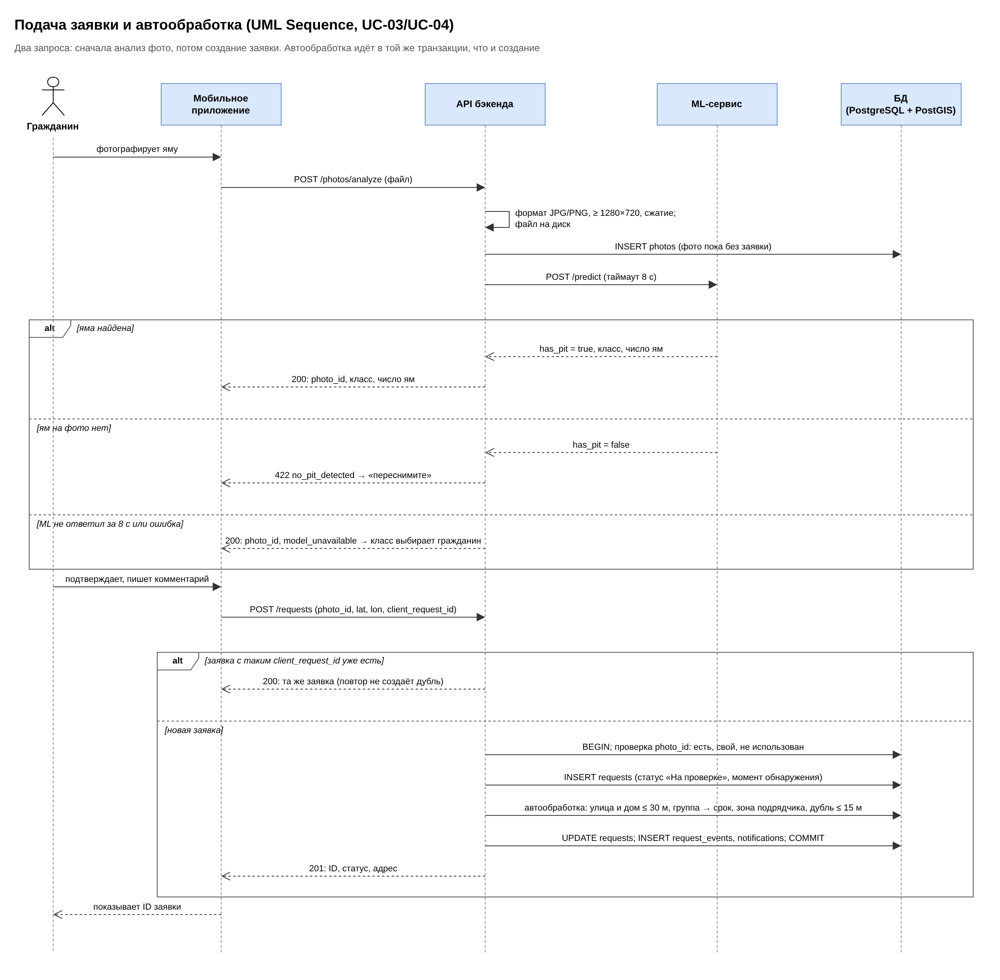
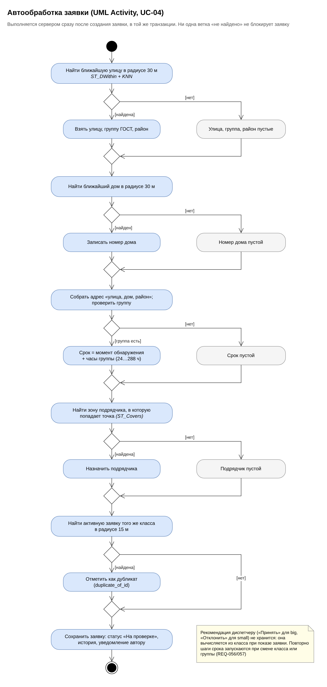
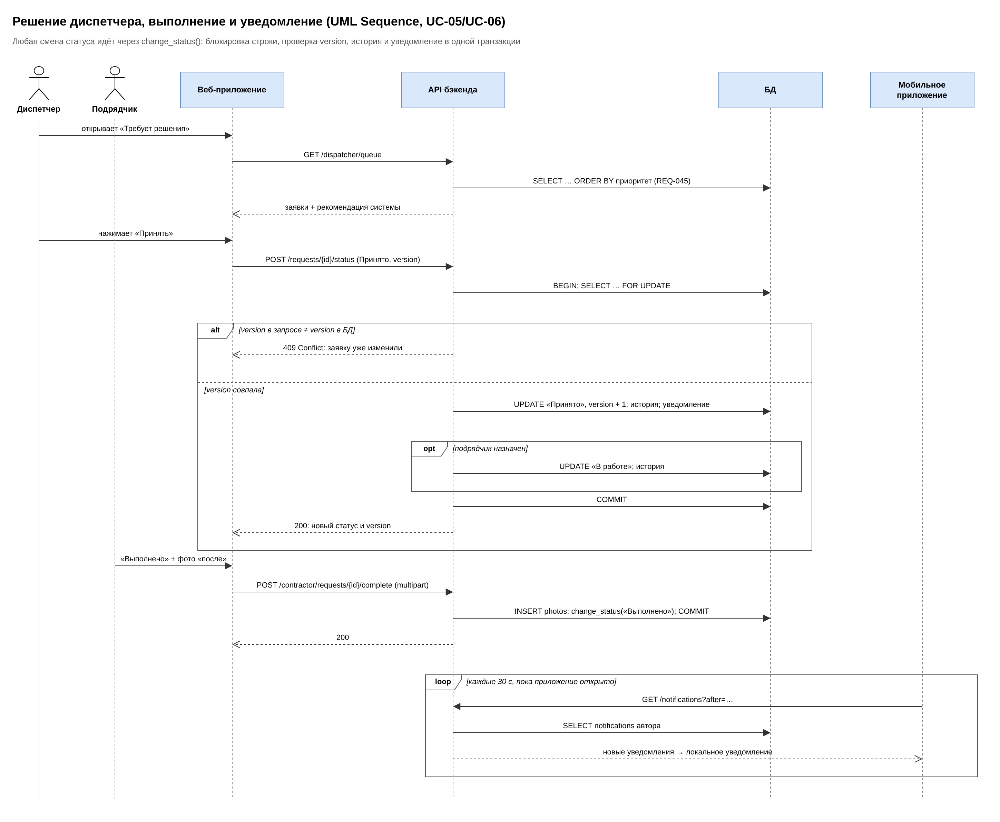

# Бэкенд «Ямочный ремонт»

Архитектура: от требований к решениям, стеку, компонентам и поведению

Сервис подачи заявок. Ямочный ремонт · ТПУ, 2026

**Версия:** 4.0 от 12.10.2026

**Автор:** Бердников А. Д., backend-разработчик

**Основание:** ЧТЗ 0.2, ТУТ 0.4, тест-план и DoD

**Связанные документы:** «Схема БД», «Вопросы и спорные ситуации», файлы draw.io (`docs/diagrams/`)

> **Уточнения после v4.0 (17.10.2026).** Документ перенесён из docx без изменений, кроме раздела 12. Что поменялось с тех пор:
>
> 1. **Монорепо.** Бэкенд лежит в `backend/`, ML-сервис в `ml_service/` (а не `ml_stub/`), конфиги nginx и мониторинга в `infra/`, `docker-compose.yml` в корне репозитория. Сервис API в compose называется `backend` (а не `api`).
> 2. **Сервер.** На хосте стоит Caddy, он держит порт 80/443 и HTTPS (домен safronspace.ru). Поэтому nginx из compose слушает другой порт (например 8080), TLS заканчивается на Caddy, а `limit_req` в nginx берёт настоящий IP клиента из `X-Forwarded-For`.
> 3. **Деплой.** `deploy.sh` хранится только на сервере в `/workspace` и в Git не добавляется. CI после слияния в `main` делает `git pull`, запускает `deploy.sh`, потом `alembic upgrade head` в контейнере `backend` и проверяет `GET /api/v1/health`.
> 4. **Адреса API.** Префикс `/api/v1`, Swagger `/api/docs`, схема `/api/openapi.json`, проверка живости `/api/v1/health`.
> 5. **Тесты.** Для `TestClient` (Starlette 1.x) в dev-зависимостях стоит `httpx2`, а не `httpx`, иначе предупреждение об устаревании.

## 1. Введение

Документ описывает серверную часть сервиса «Ямочный ремонт» в том порядке, в каком её проектировали: от требований к контексту, от контекста к решениям и стеку, затем к контейнерам, компонентам, данным и поведению. Каждый следующий раздел опирается на предыдущий, поэтому читать удобнее подряд.

### 1.1 Набор документов

Чтобы основной документ не был перегружен, материалы разделены на три документа и два файла draw.io.

| **Документ**                            | **Что в нём**                                                                                                                             | **Когда открывать**                                              |
|-----------------------------------------|-------------------------------------------------------------------------------------------------------------------------------------------|------------------------------------------------------------------|
| **Бэкенд: архитектура** (этот документ) | Требования, решения, стек, C4-диаграммы, поведение (UML), API, безопасность, эксплуатация, тесты, план                                    | Чтобы понять, как устроен бэкенд и почему так                    |
| **Схема БД**                            | 17 таблиц: назначение, поля с комментариями, связи, индексы, триггеры, начальные данные, миграции, ПДн, логическая и физическая ER-модели | При написании моделей, миграций и запросов; для Приложения 2 ЧТЗ |
| **Вопросы и спорные ситуации**          | 37 вопросов с колонкой «Ваше решение», несостыковки документов, вопросы, снятые ЧТЗ 0.2                                                   | Когда нужно принять решение или сверить документы                |
| Архитектура_бэкенда_диаграммы.drawio    | 7 страниц: C4 (контекст, контейнеры, компоненты), UML State, две UML Sequence, UML Activity                                               | Чтобы править диаграммы                                          |
| Модель_данных_ER.drawio                 | 2 страницы: логическая и физическая модели                                                                                                | Чтобы править ER-модели                                          |

Пометка **\[D\]** означает решение команды бэкенда, принятое по умолчанию, чтобы не останавливать работу. Заказчик или аналитик его не подтверждал; все такие места вынесены в документ «Вопросы и спорные ситуации».

### 1.2 Версии

| **Версия** | **Дата**   | **Что изменилось**                                                                                                                                                                                      |
|------------|------------|---------------------------------------------------------------------------------------------------------------------------------------------------------------------------------------------------------|
| 2.0        | 08.10.2026 | Обзор бэкенда, схема БД на 17 таблиц                                                                                                                                                                    |
| 3.0        | 11.10.2026 | Полное описание в одном файле, сверка с ЧТЗ 0.2, 37 вопросов                                                                                                                                            |
| 4.0        | 12.10.2026 | Разделение на три документа. Диаграммы перерисованы в нотациях C4 и UML (draw.io). Добавлены обоснование стека, пояснения про OpenAPI, Swagger, Uvicorn и GeoAlchemy2, честный ответ о покрытии тестами |

## 2. Что определяет архитектуру

Архитектуру задают не только функции, но и ограничения: нагрузка, сроки ответа, безопасность, состав команды. Ниже требования ЧТЗ 0.2, которые прямо повлияли на решения, и что из них следует.

| **Требование**         | **Что требуется**                                                                    | **Что из этого следует**                                                                             |
|------------------------|--------------------------------------------------------------------------------------|------------------------------------------------------------------------------------------------------|
| ПР-9                   | До 1000 заявок в месяц, до 50 одновременных пользователей, до 10 000 заявок в БД     | Нагрузка малая: один сервис API и одна БД, без кэшей, очередей и микросервисов                       |
| ПР-3, ПР-4             | ID заявки ≤ 10 с в 4G; проверка фото моделью ≤ 10 с                                  | Таймаут вызова ML 8 с; если модель не ответила, заявка всё равно подаётся (класс выбирает гражданин) |
| ПР-5                   | Автообработка ≤ 30 с                                                                 | Автообработка выполняется сразу, в той же транзакции, что и создание заявки                          |
| ПР-1, ПР-2, ПР-6       | Экраны ≤ 2 с, 95 % запросов API ≤ 1 с, 1000 заявок на карте ≤ 4 с                    | Индексы под каждый частый запрос, карта отдаёт только видимую область (bbox), проверка JMeter        |
| REQ-039, 041, 044, 046 | Группа улицы по точке, подрядчик по зоне, дубликаты в радиусе, участки улиц по 100 м | Нужна геобаза: PostgreSQL + PostGIS                                                                  |
| REQ-003, 004, 005      | Шесть статусов, таблица переходов, история заявки                                    | Статус меняет одна функция, история пишется в той же транзакции                                      |
| REQ-012, 061           | Каждая роль видит только своё                                                        | Проверка роли и фильтр по владельцу в SQL; отдельные схемы ответа для ролей                          |
| БЗ-1 … БЗ-4            | HTTPS, хэш пароля, сложность пароля, согласия                                        | nginx с TLS, argon2, проверка пароля, таблица согласий                                               |
| СВ-5, ДК-2             | REST API, JSON, описание в OpenAPI (Swagger)                                         | Фреймворк, который строит OpenAPI сам: FastAPI                                                       |
| СВ-6                   | Excel формируется на клиенте (SheetJS)                                               | Бэкенд отдаёт отчёты в JSON, файлы не генерирует                                                     |
| СВ-7                   | Сборка в GitHub Actions, запуск в Docker                                             | docker-compose для всех контейнеров                                                                  |
| ХР-1, НД-3             | Копия раз в сутки, 2 последние; восстановление ≤ 4 ч                                 | Ежедневный pg_dump и архив фото                                                                      |
| ЛК-2                   | Хранить в UTC, показывать томское время                                              | API отдаёт время в UTC, переводят клиенты                                                            |
| Команда и сроки        | Один бэкенд-разработчик; MVP до 23.11, финал 15.12                                   | Только простые и знакомые технологии, правила в чистых функциях для быстрых тестов                   |

### 2.1 Границы бэкенда

По ЧТЗ (п. 2.2, 3.4) бэкенд **не делает**: не определяет размеры и тип дефекта (только класс «большая» или «маленькая» яма); не даёт гражданину подтверждать или оспаривать ремонт; не ведёт переписку с заявителем (уточнение идёт вне системы); не ведёт журнал действий сотрудников (история есть только у заявки); не интегрируется с системами администрации и Госуслугами. Фото только с камеры проверяет мобильное приложение.

## 3. Контекст системы (C4, уровень 1)

Сначала система как «чёрный ящик»: кто ею пользуется и с чем она связана. У системы три типа пользователей и две внешние системы. ML-сервис здесь не показан, потому что он часть нашей системы (его делает другой участник команды) и появится на следующем уровне.



*Рисунок 1. Контекст системы (C4, уровень 1)*

Вывод для архитектуры: клиентов два (мобильное приложение и веб), оба работают через один REST API; OpenStreetMap нужен и клиентам (подложка карты), и серверу (разовая загрузка улиц и домов); push через FCM откладывается на этап 2.

## 4. Архитектурные решения

Каждое решение ниже вытекает из требований раздела 2. Для каждого указана отвергнутая альтернатива, чтобы было видно, что выбор был.

| **№** | **Решение**                                                                   | **Альтернатива**               | **Почему так**                                                                                                                                     |
|-------|-------------------------------------------------------------------------------|--------------------------------|----------------------------------------------------------------------------------------------------------------------------------------------------|
| Р-1   | **Модульный монолит** на FastAPI + отдельный ML-сервис                        | Микросервисы                   | Нагрузка мала (ПР-9), разработчик один. ML отделён, потому что у модели свои зависимости и её ведёт другой человек                                 |
| Р-2   | **Анализ фото отдельным запросом** до создания заявки                         | Фото и заявка одним запросом   | Гражданин сразу видит «яма не обнаружена» и класс (REQ-018, 019, UC-03). Заявка без фото не создаётся                                              |
| Р-3   | **Автообработка синхронно**, в транзакции создания заявки                     | Очередь задач (Celery + Redis) | Это несколько запросов по индексам, доли секунды при лимите 30 с (ПР-5). Очередь добавила бы два контейнера и состояние «заявка ещё не обработана» |
| Р-4   | **Улицы и дома из OSM загружаются в свою БД** один раз                        | Внешний геокодер (Nominatim)   | Нет зависимости от чужого сервиса и его лимитов; группа улицы по ГОСТ хранится рядом с геометрией                                                  |
| Р-5   | **Статус меняет только \`change_status()\`**                                  | Менять статус в разных местах  | История, уведомления и статус слитых дубликатов всегда согласованы; правило проверяется в одном месте                                              |
| Р-6   | **Оптимистичная блокировка** (version) и SELECT … FOR UPDATE                  | Без блокировок                 | Два диспетчера не перезапишут решения друг друга: второй получит 409                                                                               |
| Р-7   | **Снимок адреса, района и группы** в заявке                                   | Всегда брать из справочника    | Правка справочника не меняет старые заявки и отчёты (UC-12)                                                                                        |
| Р-8   | **Вычисляемое не хранится**: просрочка, приоритет, рекомендация               | Хранить флаги                  | Флаг может разойтись с данными, вычисление нет                                                                                                     |
| Р-9   | **Фото на диске** (том Docker), в БД путь; выдаёт nginx по подписанной ссылке | Фото в БД; S3 или MinIO        | База остаётся маленькой, копии простые. Тег \ не умеет передать токен, поэтому ссылка подписана и живёт 15 минут                             |
| Р-10  | **Уведомления опросом** в MVP, push через FCM к итоговой приёмке (В-30) | FCM сразу | На старте нет проекта Firebase; таблица device_tokens уже заложена. По плану проекта push — релиз 2 (30.10–03.11) |
| Р-11  | **Excel собирает клиент** (SheetJS)                                           | Генерация файла на сервере     | Так требует СВ-6; файл совпадает с таблицей предпросмотра                                                                                          |
| Р-12  | **Запуск через docker-compose**                                               | Облачный сервер                | Сервера нет (СВ-7); одинаковая среда у всей команды                                                                                                |

## 5. Стек технологий

Стек выбран под решения раздела 4: язык общий с ML-частью, фреймворк строит описание API сам, база умеет геозапросы. В таблице для каждой технологии указано, где она у нас работает, почему выбрана и что отвергли.

| **Технология**                             | **Для чего у нас**                                                               | **Почему выбрана**                                                           | **Альтернатива**                                                                            |
|--------------------------------------------|----------------------------------------------------------------------------------|------------------------------------------------------------------------------|---------------------------------------------------------------------------------------------|
| **Python 3.12**                            | Язык бэкенда                                                                     | Общий язык с ML-частью, зрелые библиотеки для геоданных и изображений        | Java + Spring, Node.js                                                                      |
| **FastAPI**                                | Веб-фреймворк: маршруты REST API, проверка данных, зависимости (роль, сессия БД) | Строит OpenAPI и Swagger из кода (СВ-5, ДК-2, см. 5.1); быстрый, асинхронный | Django REST Framework (тяжелее, своя ORM), Flask (нет проверки данных и OpenAPI из коробки) |
| **Uvicorn**                                | ASGI-сервер: принимает HTTP-соединения и передаёт запросы в FastAPI              | FastAPI сам не слушает порт, ему нужен ASGI-сервер (см. 5.2)                 | Hypercorn, Granian                                                                          |
| **Pydantic v2**, pydantic-settings         | Схемы запросов и ответов; настройки из .env                                      | Встроен в FastAPI; отдельные схемы ответа на каждую роль                     | —                                                                                           |
| **SQLAlchemy 2**, драйвер **psycopg 3**    | Модели таблиц, запросы, транзакции, FOR UPDATE                                   | Стандарт для Python, полный контроль над SQL                                 | Django ORM, SQLModel                                                                        |
| **Alembic**                                | Миграции: любое изменение схемы БД только файлом миграции                        | Родной инструмент SQLAlchemy, умеет автогенерацию                            | Ручные SQL-скрипты                                                                          |
| **GeoAlchemy2**                            | Типы geography в моделях, функции PostGIS в запросах, помощники для Alembic      | Без неё SQLAlchemy и Alembic не понимают геотипы (см. 5.3)                   | Сырой SQL                                                                                   |
| **Shapely**                                | Проверка и преобразование GeoJSON зон подрядчиков                                | Проверяет, что многоугольник корректен, до записи в БД                       | Только проверка в PostGIS                                                                   |
| **PostgreSQL 16 + PostGIS**                | База данных и геозапросы: ближайшая улица и дом, зона подрядчика, сегменты       | ST_DWithin, ST_Covers, ST_LineLocatePoint и индексы GiST                     | MySQL (слабее геофункции), MongoDB (нет связей и строгих транзакций)                        |
| **argon2-cffi**                            | Хэш паролей                                                                      | Рекомендован OWASP, разрешён БЗ-2                                            | bcrypt                                                                                      |
| **PyJWT**                                  | Access- и refresh-токены                                                         | Простой и поддерживаемый                                                     | python-jose                                                                                 |
| **httpx**                                  | Вызов ML-сервиса с таймаутом                                                     | Асинхронный; в тестах ML подменяется без сети                                | requests                                                                                    |
| **Pillow**                                 | Проверка формата и разрешения фото, сжатие                                       | ФТ-1, ФТ-2                                                                   | —                                                                                           |
| **python-multipart**                       | Приём файлов в запросах multipart/form-data                                      | Без него FastAPI не принимает загрузку файлов                                | —                                                                                           |
| **nginx**                                  | HTTPS, раздача веба, /api → API, лимит попыток входа, выдача фото                | Надёжный и простой обратный прокси                                           | Caddy, Traefik                                                                              |
| **Prometheus, Grafana**                    | Метрики и дашборд                                                                | Цифры для ПР-1, ПР-2 (СВ-8 в ТУТ)                                            | —                                                                                           |
| **Apache JMeter**                          | Нагрузочный тест на 50 пользователей                                             | Стандартный инструмент                                                       | Locust, k6                                                                                  |
| **pytest, pytest-cov, ruff**               | Тесты, покрытие, стиль кода                                                      | Стандарт для Python                                                          | —                                                                                           |
| **Docker, docker-compose, GitHub Actions** | Запуск всех контейнеров, проверка каждого PR                                     | СВ-7                                                                         | —                                                                                           |

Клиенты (не бэкенд, для полноты): веб на React + Vite, карта Leaflet с тайлами OSM (СВ-4), Excel через SheetJS (СВ-6); мобильное приложение под Android 9+ (СВ-1).

### 5.1 Почему REST API, OpenAPI и Swagger «формируются автоматически»

Сам REST API мы пишем руками: каждый запрос это функция на Python. Автоматически появляется **описание** этого API. FastAPI читает у функции метод и путь, типы параметров и модели Pydantic для тела запроса и ответа, и по ним строит документ OpenAPI (/api/openapi.json). Swagger UI (/api/docs) это веб-страница, которая показывает этот документ и даёт отправить запрос прямо из браузера.

**Аналогия:** меню в ресторане печатается прямо из техкарт кухни. Добавили блюдо, оно появилось в меню; поменяли состав, меню поменялось само. Поэтому меню (описание API) не может разойтись с тем, что на самом деле готовит кухня (код).

Что это даёт: описание API всегда актуально (ДК-2); веб получает TypeScript-типы из openapi.json; те же модели Pydantic проверяют входящие данные, поэтому неверный запрос получает 422 до бизнес-логики.

### 5.2 Зачем нужен Uvicorn

FastAPI это фреймворк: набор правил, как ответить на запрос. Сам он не умеет слушать сетевой порт и разбирать HTTP. Это делает **ASGI-сервер** Uvicorn: открывает порт 8000, принимает соединения, разбирает HTTP, передаёт запрос в FastAPI по стандарту ASGI и отправляет ответ обратно. Документация FastAPI прямо говорит, что для запуска нужна программа ASGI-сервера, например Uvicorn.

**Аналогия:** FastAPI это повар с рецептами, Uvicorn это официанты, которые принимают заказы в зале и приносят блюда, а nginx это охрана на входе: проверяет HTTPS, не пускает слишком частых гостей (лимит попыток входа) и сам выдаёт готовое со склада (фото).

```bash
uvicorn app.main:app --host 0.0.0.0 --port 8000 --workers 2
```

### 5.3 Почему нет «AlembicGIS» и что вместо него

Инструмента «AlembicGIS» не существует. Есть **Alembic** (миграции) и **GeoAlchemy2** (геотипы для SQLAlchemy). Проблема в том, что сам Alembic не знает про типы PostGIS: при автогенерации миграции он не импортирует тип Geography, пытается удалить служебные таблицы PostGIS (например spatial_ref_sys) и путается в пространственных индексах. Для этого в GeoAlchemy2 есть модуль geoalchemy2.alembic_helpers, который подключается в migrations/env.py:

```python
from geoalchemy2 import alembic_helpers

context.configure(
    ...,
    include_object=alembic_helpers.include_object,            # не трогать служебные таблицы PostGIS
    process_revision_directives=alembic_helpers.writer,       # правильно создавать геоколонки и GiST
    render_item=alembic_helpers.render_item,                  # импорт геотипов в файле миграции
)
```

Первая миграция включает расширение: CREATE EXTENSION IF NOT EXISTS postgis. GeoAlchemy2 добавлен в стек; ранее его не было, хотя геотипы используются в 6 таблицах.

### 5.4 Что сознательно не используем

Redis и Celery (нет фоновых очередей, см. Р-3), Nominatim и другие геокодеры (Р-4), S3 и MinIO (Р-9), FastReport и генерацию Excel на сервере (Р-11), микросервисы (Р-1). Если нагрузка вырастет, первым кандидатом на вынос будет вызов ML в очередь.

## 6. Контейнеры (C4, уровень 2)

Раскрываем систему из раздела 3: из каких отдельно запускаемых частей она состоит. Каждая часть ниже это отдельный контейнер Docker в docker-compose.yml, кроме клиентов.



*Рисунок 2. Контейнеры системы (C4, уровень 2)*

| **Контейнер**  | **Технология**                | **Что делает**                                                                                                              | **Порт**   |
|----------------|-------------------------------|-----------------------------------------------------------------------------------------------------------------------------|------------|
| Прокси         | nginx                         | HTTPS (TLS 1.2+, HSTS), раздача веба, /api → API, лимит попыток входа, выдача фото по подписанной ссылке (X-Accel-Redirect) | 80 / 443   |
| API бэкенда    | Python 3.12, FastAPI, Uvicorn | Вся бизнес-логика, ночные фоновые задачи                                                                                    | 8000       |
| База данных    | PostgreSQL 16 + PostGIS       | 17 таблиц, геоданные                                                                                                        | 5432       |
| Хранилище фото | Том Docker /data/photos       | Файлы фото «до» и «после»; в БД только путь и размеры                                                                       | —          |
| ML-сервис      | Python, HTTP                  | Находит яму на фото, класс и число ям. На старте заглушка с режимом «модель недоступна»                                     | 8001       |
| Мониторинг     | Prometheus, Grafana           | Время ответа, число запросов, ошибки                                                                                        | 9090, 3000 |

Наружу открыт только nginx. Остальные контейнеры доступны друг другу по внутренней сети Docker, поэтому база и ML-сервис не видны из интернета.

## 7. Компоненты API (C4, уровень 3)

Раскрываем контейнер «API бэкенда». Запрос проходит три слоя: роутер (HTTP и права) → сервис (бизнес-правила и транзакция) → доступ к данным.



*Рисунок 3. Компоненты API бэкенда (C4, уровень 3)*

### 7.1 Модули в коде

На диаграмме компоненты показаны крупно. В коде они разложены по модулям, у каждого модуля одинаковые файлы: router.py (запросы и роли), service.py (сценарий и транзакция), models.py (таблицы), schemas.py (Pydantic).

| **Модуль**     | **Компонент на рис. 3** | **Отвечает за**                                                   | **Таблицы**                                                      | **UC**     |
|----------------|-------------------------|-------------------------------------------------------------------|------------------------------------------------------------------|------------|
| auth           | Авторизация             | Регистрация, вход, токены, согласия                               | users, citizens, contractor_users, user_consents, refresh_tokens | 01, 02     |
| media          | Фото                    | Приём и проверка фото, подписанные ссылки                         | photos                                                           | 03, 06     |
| ml_client      | Клиент ML               | Вызов модели, таймаут 8 с, режим «недоступна»                     | —                                                                | 03         |
| requests       | Заявки                  | Заявка, change_status(), история, слияние, заметки                | requests, request_events, internal_notes                         | 03, 05–07  |
| processing     | Автообработка           | Автообработка новой заявки и пересчёт при смене класса или группы | requests, streets, buildings, contractors                        | 04         |
| geo            | Доступ к данным         | Запросы PostGIS: улица, дом, зона, сегмент                        | streets, buildings, districts, contractors                       | 04, 08     |
| notifications  | Заявки                  | Уведомления гражданину                                            | notifications, device_tokens (этап 2)                            | 07         |
| planned_repair | Справочники и отчёты    | Участки 100 м, пороги, предложения                                | planned_repair_proposals                                         | 10         |
| reports        | Справочники и отчёты    | Карта, тепловая карта, отчёты, рейтинг                            | requests (чтение)                                                | 08, 09, 11 |
| admin          | Справочники и отчёты    | Справочники, сроки, пользователи                                  | districts, streets, street_groups, contractors, users            | 12, 13     |

### 7.2 Правила устройства кода

1.  **Правила в чистых функциях** (core/rules.py, core/validators.py): переходы статусов, сроки, просрочка, рекомендация, пороги, адрес. Без БД и без системных часов (время передаётся параметром), поэтому проверяются быстрыми юнит-тестами.

2.  **Значения, которые меняет диспетчер, лежат в таблицах**, а не в коде: сроки и пороги групп (REQ-073, 074). Радиусы поиска лежат в .env.

3.  **Роутер не ходит в БД напрямую**, только через сервис; сервис открывает одну транзакцию на сценарий.

4.  **Время в UTC**, перевод в томское время (UTC+7) делают клиенты (ЛК-2).

## 8. Данные

Компоненты из раздела 7 работают с базой из 17 таблиц в четырёх группах. Полное описание полей, связей, индексов, триггеров и миграций вынесено в документ **«Схема БД»**, здесь только то, что нужно для понимания поведения в разделе 9.

| **Группа**              | **Таблицы**                                                                     | **Что хранят**                                                                         |
|-------------------------|---------------------------------------------------------------------------------|----------------------------------------------------------------------------------------|
| Справочники и геоданные | districts, street_groups, streets, buildings, contractors                       | Районы; группы А–Е со сроком и порогом; улицы и дома из OSM; подрядчики с зонами       |
| Пользователи и доступ   | users, citizens, contractor_users, user_consents, refresh_tokens, device_tokens | Учётные записи; телефон гражданина; привязка сотрудника к подрядчику; согласия; токены |
| Заявки                  | requests, photos, request_events, internal_notes, notifications                 | Заявка; фото; история; заметки диспетчеров; уведомления                                |
| Плановый ремонт         | planned_repair_proposals                                                        | Предложения по участкам улиц 100 м                                                     |

Три правила данных, на которые опирается поведение: **заявка не существует без фото «до»** (before_photo_id NOT NULL); **адрес, район и группа копируются в заявку** на момент подачи; **пользователи не удаляются**, а отключаются, чтобы не потерять авторов заявок и историю.

## 9. Поведение системы

Раздел показывает, как контейнеры и компоненты работают вместе. Порядок диаграмм повторяет жизнь заявки: сначала её статусы целиком, затем подача, автообработка, решение и выполнение.

### 9.1 Статусы заявки (UML State Machine)



*Рисунок 4. Жизненный цикл заявки*

| **Из**            | **В**               | **Кто**   | **Условие**                                                              |
|-------------------|---------------------|-----------|--------------------------------------------------------------------------|
| — (создание)      | На проверке         | система   | При регистрации заявки                                                   |
| На проверке       | Принято             | диспетчер | Если подрядчик назначен, система сразу переводит в «В работе»            |
| На проверке       | Отклонено           | диспетчер | Причина в decision_comment обязательна                                   |
| На проверке       | Требует уточнения   | диспетчер | Уточнение вне системы, например звонком (REQ-038, 047)                   |
| Требует уточнения | Принято / Отклонено | диспетчер | После уточнения; при отклонении причина обязательна                      |
| Принято           | В работе            | система   | Сразу, если подрядчик назначен; иначе после ручного назначения (REQ-043) |
| В работе          | Выполнено           | подрядчик | Только с фото «после» (REQ-063)                                          |

Статус меняет только функция change_status(), в одной транзакции: блокирует строку (SELECT … FOR UPDATE), проверяет переход, роль и version, пишет статус и событие status_changed, копирует статус слитым дубликатам, создаёт уведомления и, если это малая яма, пересчитывает её участок для планового ремонта. Из «Отклонено» и «Выполнено» выхода нет; других переходов, кроме таблицы ЧТЗ, нет (В-4: изменение только после согласования с заказчиком).

```python
# Статусы хранятся кодами, русские подписи — app/core/statuses.py (В-37)
ALLOWED = {
    ("on_review", "accepted"): {"dispatcher"},
    ("on_review", "rejected"): {"dispatcher"},               # причина обязательна
    ("on_review", "needs_clarification"): {"dispatcher"},
    ("needs_clarification", "accepted"): {"dispatcher"},
    ("needs_clarification", "rejected"): {"dispatcher"},
    ("accepted", "in_progress"): {"system"},                 # подрядчик назначен
    ("in_progress", "done"): {"contractor"},                 # с фото «после»
}
```

### 9.2 Подача заявки (UML Sequence)

Подача идёт двумя запросами (решение Р-2). Первый проверяет фото и вызывает модель, второй создаёт заявку и сразу выполняет автообработку. Рамка alt показывает три исхода проверки фото и защиту от повторной отправки.



*Рисунок 5. Подача заявки и автообработка (UC-03, UC-04)*

### 9.3 Автообработка (UML Activity)

Раскрывает шаг «автообработка» из рисунка 5. Каждое решение имеет ветку «не найдено», и ни одна из них не останавливает заявку: пустое поле становится пометкой для диспетчера.



*Рисунок 6. Автообработка заявки (UC-04)*

| **Если не найдено**                        | **Что пишется в заявку**                       | **Что видит диспетчер**                                                     |
|--------------------------------------------|------------------------------------------------|-----------------------------------------------------------------------------|
| Улица в радиусе 30 м или улица без группы  | Улица (или пусто), группа и срок пусто         | Пометка «нужна группа»; указывает группу, срок считается сразу (UC-05 А6)   |
| Дом в радиусе 30 м                         | Номер дома пуст, адрес «улица, район»          | Ничего особенного                                                           |
| Зона подрядчика                            | Подрядчик пуст                                 | Пометка «нужен подрядчик» (REQ-042); после «Принято» заявка ждёт назначения |
| Активная заявка того же класса в 15 м есть | duplicate_of_id                                | Пометка «возможный дубликат»: объединить или снять пометку                  |
| ML не ответил (рис. 5)                     | Класс выбрал гражданин, class_source = citizen | Отметка «класс выбран вручную» (REQ-022)                                    |

### 9.4 Решение, выполнение и уведомление (UML Sequence)

Показывает конкурентную правку (alt по version), автоматический переход в «В работе» (opt) и опрос уведомлений приложением (loop).



*Рисунок 7. Решение диспетчера, выполнение и уведомление (UC-05, UC-06, UC-07)*

### 9.5 Бизнес-правила и формулы

Все правила реализованы чистыми функциями и покрыты юнит-тестами. Где вычисляемое значение используется в БД, см. раздел «Что вычисляется» в документе «Схема БД».

| **Правило**         | **Как считается**                                                                                                                                                 | **Источник**           |
|---------------------|-------------------------------------------------------------------------------------------------------------------------------------------------------------------|------------------------|
| Подлежит устранению | defect_class = big; не хранится                                                                                                                                   | REQ-036                |
| Рекомендация        | big → «Принято»; small → «Отклонено» с текстом про плановый ремонт; считается при показе                                                                          | REQ-037, UC-04         |
| Срок устранения     | planned_due_at = detected_at + deadline_hours группы; от регистрации, в часах. А 24, Б 72, В 120, Г 168, Д 240, Е 288 ч                                           | REQ-040, глоссарий ЧТЗ |
| Просрочка           | planned_due_at \< now() и статус «Принято» или «В работе»                                                                                                         | REQ-062                |
| Улица и дом         | Ближайшая линия streets и точка buildings в радиусе 30 м (ST_DWithin + сортировка по расстоянию)                                                                  | REQ-039                |
| Адрес               | «улица, дом, район»; без дома «улица, район»; без улицы пусто                                                                                                     | REQ-002, 015           |
| Подрядчик           | Зона подрядчика содержит точку (ST_Covers); зоны не пересекаются (В-19); неактивный подрядчик не назначается (В-7) | REQ-041, 042 |
| Дубликат            | Активная заявка того же класса в радиусе 15 м **\[D\]**                                                                                                           | REQ-044                |
| Слияние             | merged_into_id, у основной duplicates_count + 1; глубина цепочки всегда 1                                                                                         | REQ-059                |
| Приоритет           | класс (big выше) → duplicates_count ↓ → группа А→Е → detected_at → planned_due_at (В-11) | REQ-045 |
| Участок улицы       | segment_idx = floor(ST_LineLocatePoint(линия, точка) × длина / 100)                                                                                               | REQ-046                |
| Плановый ремонт     | Число отклонённых с reject_reason = small_pit малых не слитых заявок участка (одна заявка — одна яма, В-15) больше порога текущей группы улицы (А, Б 2; В 10; Г 16; Д 42; Е 104) → предложение открыто; иначе закрыто **\[D\]** (закрытие, В-16) | REQ-046, UC-10 |
| Выполнено в срок    | completed_at ≤ planned_due_at **\[D\]**                                                                                                                           | REQ-066                |
| Среднее время       | completed_at − detected_at по выполненным заявкам                                                                                                                 | REQ-068                |
| Отчёт = карта       | Один фильтр на /requests, /map/\*, /reports/\*; слитые не считаются (В-18) | REQ-067 |

## 10. API

Поведение из раздела 9 доступно клиентам через REST API. Здесь договорённости и состав запросов; точные поля каждого запроса смотреть в Swagger (/api/docs), он строится из кода (раздел 5.1).

### 10.1 Роли и доступ

Ролей три (REQ-011). Функции руководителя и администратора выполняет диспетчер. Доступ проверяется в два слоя: роль открывает группу запросов, а фильтр по владельцу в SQL ограничивает, какие именно заявки видны.

| **Группа запросов**                                     | **Без токена** | **Гражданин** | **Диспетчер** | **Подрядчик**          |
|---------------------------------------------------------|----------------|---------------|---------------|------------------------|
| Вход, регистрация                                       | да             | да            | да            | да                     |
| Анализ фото, создание заявки, свои заявки и уведомления | 401            | да            | 403           | 403                    |
| Список заявок, карта, отчёты, действия над заявками     | 401            | 403           | да            | 403                    |
| Карточка заявки GET /requests/{id}                      | 401            | 403           | да            | только своя, иначе 404 |
| Заявки подрядчика и завершение                          | 401            | 403           | 403           | да                     |
| Справочники и пользователи                              | 401            | 403           | да            | 403                    |

Подрядчику не отдаются телефон и данные заявителя, гражданину не отдаются заметки диспетчеров; диспетчер видит телефон заявителя только в статусе «Требует уточнения» (REQ-047, В-27): у каждой роли своя схема ответа Pydantic. Чужая заявка возвращает 404, а не 403, чтобы не раскрывать её существование **\[D\]**.

### 10.2 Общие правила

| **Правило**          | **Значение**                                                                                                                                   |
|----------------------|------------------------------------------------------------------------------------------------------------------------------------------------|
| **Адрес**            | Префикс /api/v1; Swagger /api/docs; проверка живости GET /api/v1/health                                                                        |
| **Формат и время**   | JSON; время в UTC, ISO-8601 с Z                                                                                                                |
| **Авторизация**      | Authorization: Bearer \<access\>; access 30 мин, refresh 14 дней с ротацией. При 401 клиент один раз вызывает /auth/refresh и повторяет запрос |
| **Раздельные входы** | Гражданин /auth/citizen/\*, сотрудники /auth/staff/login: роль не войдёт в чужое приложение (REQ-001)                                          |
| **Идемпотентность**  | Повтор POST /requests с тем же client_request_id возвращает ту же заявку (UC-03 А5, А6)                                                        |
| **Конфликты**        | Действия диспетчера передают version; если заявку уже изменили, ответ 409                                                                      |
| **Ошибки**           | {code, message, details}, сообщение на русском                                                                                                 |
| **Статусы**          | Объект {code, label}: код (on_review, accepted, rejected, needs_clarification, in_progress, done) и русская подпись; фильтры принимают код (В-37) |
| **Пагинация**        | limit и offset **\[D\]**                                                                                                                       |

| **Код**      | **Когда**                                                                                                                |
|--------------|--------------------------------------------------------------------------------------------------------------------------|
| **200, 201** | Успех                                                                                                                    |
| **401**      | Нет токена или он недействителен; неверный логин или пароль                                                              |
| **403**      | Роль не подходит; подпись ссылки на фото неверна или истекла                                                             |
| **404**      | Нет такой заявки или она чужая                                                                                           |
| **409**      | Занят email или телефон; конфликт version; недопустимый переход; фото уже использовано; справочник используется          |
| **413**      | Файл фото больше лимита **\[D\]**                                                                                        |
| **422**      | Ошибка данных: формат, слабый пароль, нет согласия, нет причины отклонения, неверная зона, чужое фото, яма не обнаружена |
| **429**      | Слишком много попыток входа (nginx)                                                                                      |

### 10.3 Состав запросов

| **Метод и путь**                                                 | **Что делает**                                             | **Роль**                 | **Этап** |
|------------------------------------------------------------------|------------------------------------------------------------|--------------------------|----------|
| POST /auth/citizen/register                                      | Создаёт users, citizens и два согласия в одной транзакции  | —                        | MVP      |
| POST /auth/citizen/login, POST /auth/staff/login                 | Вход: access, refresh, role (подрядчику ещё contractor_id) | —                        | MVP      |
| POST /auth/refresh, POST /auth/logout, GET /me                   | Обновление с ротацией, выход, текущий пользователь         | все                      | MVP      |
| POST /photos/analyze                                             | Проверка фото и ML: photo_id, класс, число ям или ошибка   | гражд.                   | MVP      |
| POST /requests                                                   | Создание заявки и автообработка                            | гражд.                   | MVP      |
| GET /me/requests, GET /me/requests/{id}                          | Свои заявки; детали с историей и фото                      | гражд.                   | MVP      |
| GET /me/notifications?since=, POST /me/notifications/read        | Опрос и отметка прочтения                                  | гражд.                   | MVP      |
| GET /requests, GET /requests/{id}, GET /requests/{id}/events     | Список с фильтрами и sort=priority; карточка; история      | дисп. (карточка и подр.) | MVP      |
| PATCH /requests/{id}/status                                      | Смена статуса: to, comment, version                        | дисп.                    | MVP      |
| PATCH /requests/{id}/class, PATCH /requests/{id}/street-group    | Правка класса или группы, пересчёт срока                   | дисп.                    | MVP      |
| PUT /requests/{id}/contractor                                    | Назначить или сменить подрядчика                           | дисп.                    | MVP      |
| POST /requests/{id}/merge, DELETE /requests/{id}/duplicate-flag  | Слить с into_id или снять пометку дубликата                | дисп.                    | MVP      |
| GET, POST /requests/{id}/notes                                   | Внутренние заметки                                         | дисп.                    | MVP      |
| GET /map/points                                                  | Маркеры по фильтрам и bbox                                 | дисп.                    | MVP      |
| GET /contractor/requests, GET /contractor/requests/{id}          | Свои заявки с is_overdue                                   | подр.                    | MVP      |
| POST /contractor/requests/{id}/complete                          | Фото «после», статус и дата в одной транзакции             | подр.                    | MVP      |
| CRUD /streets, /districts, /contractors; GET, PUT /street-groups | Справочники, сроки и пороги                                | дисп.                    | MVP      |
| CRUD /users, POST /users/{id}/reset-password                     | Сотрудники                                                 | дисп.                    | MVP      |
| GET /map/heatmap, GET /map/zones                                 | Тепловая карта, слой зон                                   | дисп.                    | Этап 2   |
| GET /planned-repairs, GET /planned-repairs/{id}                  | Предложения планового ремонта и их состав                  | дисп.                    | Этап 2   |
| GET /reports/count, GET /reports/avg-time                        | Отчёты, group_by=district\|contractor                      | дисп.                    | Этап 2   |
| GET /contractors/rating, /contractors/{id}/history               | Рейтинг и история подрядчика                               | дисп.                    | Этап 2   |

### 10.4 Договорённости с клиентами

- **Фото:** ссылки photo_before_url, photo_after_url подписаны и живут 15 минут; у слитой заявки фото «после» берётся у основной.

- **Карта:** /map/points принимает bbox и отдаёт минимум полей. Тепловая карта /map/heatmap — окраска дорог: GeoJSON-линии с числом ям и уровнем цвета по весу ям на 100 м (большая 1, маленькая 0,5; пороги 2 / 4 / 7 **\[D\]**); детальность по zoom: улица целиком, кусок улицы, участок 100 м.

- **Отчёты:** JSON; веб строит предпросмотр, SheetJS сохраняет его в .xlsx (REQ-071, 072).

- **Уведомления:** приложение опрашивает /me/notifications раз в 30 с; к итоговой приёмке добавляется push через FCM (В-30) без изменения схемы.

- **Типы для фронта** генерируются из openapi.json; CORS разрешён только адресу веба.

## 11. Безопасность

Меры по требованиям БЗ ЧТЗ. Какие персональные данные хранятся и где, описано в документе «Схема БД», раздел «Безопасность и персональные данные».

| **Тема**        | **Как сделано**                                                                                                                                     | **Требование** |
|-----------------|-----------------------------------------------------------------------------------------------------------------------------------------------------|----------------|
| Передача        | Только HTTPS (TLS 1.2+) на nginx, HSTS; CORS только для веба                                                                                        | БЗ-1           |
| Пароли          | argon2; не меньше 8 символов, буквы разных регистров и цифры                                                                                        | БЗ-2, БЗ-3     |
| Согласия        | Без согласия на ПДн и отдельного на геолокацию регистрация невозможна; хранятся версия текста и время                                               | БЗ-4, REQ-007  |
| Токены          | Access 30 мин; refresh 14 дней с ротацией, в БД только хэш SHA-256. Повтор отозванного refresh считается кражей: отзываются все токены пользователя | —              |
| Подбор пароля   | limit_req в nginx на запросы входа                                                                                                                  | —              |
| Доступ к данным | Роль + фильтр по владельцу в SQL; схемы ответа по ролям                                                                                             | REQ-012, 061   |
| Фото            | Подписанные ссылки HMAC на 15 минут, файл отдаёт nginx                                                                                              | —              |
| Секреты         | Только в .env, не в репозитории                                                                                                                     | —              |

## 12. Развёртывание и эксплуатация

Отдельная диаграмма развёртывания не нужна: всё запускается одним docker-compose.yml на одной машине, и расположение контейнеров совпадает с рисунком 2 (порты в разделе 6).

### 12.1 Репозиторий

> Обновлено 17.10.2026: репозиторий команды — монорепо, поэтому раскладка отличается от первоначальной (v4.0). Актуальная схема ниже, правила работы с репозиторием — в `dev-plan.md`.

```
neo-pothole-service/
├── backend/                     # наш код (FastAPI)
│   ├── app/main.py config.py db.py
│   ├── app/core/rules.py validators.py         # чистые правила, без БД и часов
│   ├── app/modules/<модуль>/router.py service.py models.py schemas.py
│   ├── migrations/              # Alembic + geoalchemy2.alembic_helpers
│   ├── scripts/                 # load_streets.py, load_buildings.py, street_groups.csv, seed_demo.py, backup.sh
│   ├── tests/unit  tests/integration  tests/e2e
│   └── Dockerfile  pyproject.toml  requirements.txt  requirements-dev.txt
├── ml_service/                  # ML-сервис (заглушка в PR 1-8, модель ведёт ML-разработчик)
├── infra/                       # nginx.conf, prometheus.yml, дашборд Grafana
├── frontend/  mobile/           # клиенты, их ведут другие участники
├── tests/                       # общий тестовый контур (JMeter, smoke)
├── .env.example                 # в корне: его читают compose и шаг деплоя
└── docker-compose.yml           # в корне; сервисы: db, backend, ml_service, nginx
```

### 12.2 Настройки и первый запуск

| **Настройка (.env)**                                               | **Пример**                                    | **Зачем**        |
|--------------------------------------------------------------------|-----------------------------------------------|------------------|
| DATABASE_URL                                                       | postgresql+psycopg://app:app@db:5432/potholes | Подключение к БД |
| JWT_SECRET, JWT_ACCESS_MINUTES, JWT_REFRESH_DAYS                   | секрет, 30, 14                                | Токены           |
| PHOTOS_DIR                                                         | /data/photos                                  | Папка фото       |
| ML_URL, ML_TIMEOUT_SECONDS                                         | http://ml_service:8001, 8                        | ML-сервис        |
| STREET_MATCH_RADIUS_M, BUILDING_MATCH_RADIUS_M, DUPLICATE_RADIUS_M | 30, 30, 15                                    | Радиусы поиска   |
| CORS_ORIGINS                                                       | http://localhost:5173                         | Адрес веба       |

```bash
cp .env.example .env
docker compose up -d --build
docker compose exec backend alembic upgrade head
docker compose exec backend python -m scripts.load_streets
docker compose exec backend python -m scripts.load_buildings
docker compose exec backend python -m scripts.seed_demo
docker compose exec backend python -m scripts.load_zones
```

### 12.3 Фоновые задачи, копии и мониторинг

| **Что**                               | **Когда**   | **Как**                                                                                                       |
|---------------------------------------|-------------|---------------------------------------------------------------------------------------------------------------|
| Удаление фото без заявки              | Ночью       | Фото старше 24 часов, на которые не ссылается ни одна заявка, удаляются вместе с файлом **\[D\]**             |
| Удаление просроченных refresh-токенов | Ночью       | Строки с expires_at \< now()                                                                                  |
| Резервная копия                       | Раз в сутки | backup.sh: pg_dump и архив тома фото, хранятся 2 последние (ХР-1). Восстановление ≤ 4 ч, потеря ≤ 24 ч (НД-3) |
| Метрики                               | Постоянно   | /metrics → Prometheus → дашборд Grafana: время ответа, число запросов, ошибки 5xx                             |
| Нагрузочный тест                      | Фаза 6      | Один план JMeter на 50 пользователей: ПР-1, ПР-2, ПР-6                                                        |

Объём: строк в БД мало, основной объём дают фото. При 1000 заявок в месяц, 2 фото на заявку и 2–5 МБ на фото это 4–10 ГБ в месяц.

## 13. Качество: тесты и покрытие

| **Вид тестов** | **План**  | **Что проверяют**                                                                                                                                                                                                             |
|----------------|-----------|-------------------------------------------------------------------------------------------------------------------------------------------------------------------------------------------------------------------------------|
| Юнит           | 28 тестов | Чистые правила: переходы, сроки А–Е, просрочка на границе, рекомендация, пороги, сегмент (99,9 м → 0, 100 м → 1), пароль, телефон, фото 1280×720, адрес                                                                       |
| Интеграционные | 63 теста  | PostGIS и API: улица и дом в 30 и 31 м, дубликат в 15 и 16 м, зона подрядчика, заявка без фото, чужое и повторное фото, CHECK статусов, приоритет, идемпотентность, число уведомлений, матрица «запрос × роль», отчёт = карта |
| Контрактные    | 4 теста   | OpenAPI, формат ошибок, формат времени, версия API                                                                                                                                                                            |
| Сквозные       | 2 теста   | Полный цикл заявки; проверка после запуска                                                                                                                                                                                    |

### 13.1 Сколько покрытие юнит-тестами

> **Измерено 26.10.2026 (конец фазы 2), pytest-cov по строкам:**
>
> | Что | Тесты | Покрытие |
> | --- | --- | --- |
> | app/core (правила и проверки) | только быстрые | **100 %** |
> | core/ и все service.py | быстрые + интеграционные + e2e (262 теста) | **97 %** |
> | core/ и все service.py | только быстрые (102 теста, без БД) | 44 % |
>
> Сервисы работают с PostGIS, поэтому их проверяют интеграционные тесты. Порог 60 % в быстром job CI считается без базы и с фазы 2 не проходит: покрытие нужно считать в job с PostGIS (решение с Егором, ci.yml).

**CI (GitHub Actions):** ruff → pytest с PostGIS → покрытие → сборка образа. Слияние в main только при зелёном CI и одобрении ревью. Тесты называются по требованию (test_req_040\_…), на каждый баг пишется регрессионный тест.

## 14. План работ

| **Фаза** | **Срок**    | **Результат**                                                                        |
|----------|-------------|--------------------------------------------------------------------------------------|
| 1        | 06–12.10    | Репозиторий, compose, миграции, загрузка улиц и домов, seed, OpenAPI v1, заглушка ML |
| 2        | 13–26.10    | Сквозной сценарий: подача → автообработка → решение → выполнение → статус (UC-03…07) |
| 3        | 27.10–09.11 | Панель, карточка, уведомления, карта, фильтры                                        |
| 4        | 10–23.11    | Дубликаты и слияние, справочники, пользователи, зоны. **Конец MVP**                  |
| 5        | 24–30.11    | Отчёты, рейтинг, плановый ремонт                                                     |
| 6        | 01–07.12    | JMeter, Grafana, безопасность, баги, документация                                    |
| 7        | 08–15.12    | Буфер и демо                                                                         |

Если не успеваем, сокращаем в таком порядке: рейтинг (REQ-066), история подрядчика (065), слой зон (053), плановый ремонт (046), тепловая карта (052).

### 14.1 Риски

| **Риск**                                | **Что делаем**                                       |
|-----------------------------------------|------------------------------------------------------|
| Один разработчик бэкенда на весь объём  | Порядок сокращений выше                              |
| Плохое покрытие домов в OSM по Томску   | Проверить до загрузки; номер дома необязателен       |
| Мониторинг и нагрузка съедят фазу 6     | Один дашборд и один план JMeter                      |
| Android 9+ не пускает HTTP в разработке | Настройка домена разработки или туннель с HTTPS      |
| Документы расходятся                    | Порядок обновления: миграция → «Схема БД» → ER → ЧТЗ |

## Приложение А. Трассировка требований

Все 70 функциональных требований ЧТЗ 0.2 и то, чем бэкенд их закрывает. Требования со статусом «Отказ» (017, 020, 021, 029, 030, 033, 069, 076) не реализуются.

| **Требование** | **Название**                     | **Чем закрывается**                                             | **Этап**       |
|----------------|----------------------------------|-----------------------------------------------------------------|----------------|
| REQ-ЯР-001     | Состав системы                   | Отдельные входы /auth/citizen/\*, /auth/staff/login; users.role | MVP            |
| REQ-ЯР-002     | Состав данных заявки             | POST /requests; requests, photos, request_events                | MVP            |
| REQ-ЯР-003     | Статусная модель                 | requests.status CHECK на 6 значений                             | MVP            |
| REQ-ЯР-004     | Переходы                         | change_status(), таблица ALLOWED                                | MVP            |
| REQ-ЯР-005     | Фиксация истории                 | request_events                                                  | MVP            |
| REQ-ЯР-006     | Отображение истории              | GET /requests/{id}/events, GET /me/requests/{id}                | MVP            |
| REQ-ЯР-007     | Регистрация                      | POST /auth/citizen/register; users, citizens, user_consents     | MVP            |
| REQ-ЯР-008     | Вход гражданина                  | POST /auth/citizen/login; refresh_tokens                        | MVP            |
| REQ-ЯР-009     | Заявка только после входа        | JWT обязателен на POST /requests                                | MVP            |
| REQ-ЯР-010     | Вход сотрудников                 | POST /auth/staff/login                                          | MVP            |
| REQ-ЯР-011     | Роли сотрудников                 | users.role, POST /users                                         | MVP            |
| REQ-ЯР-012     | Разграничение доступа            | Проверка роли + фильтр владельца в SQL                          | MVP            |
| REQ-ЯР-013     | Диспетчер видит все заявки       | GET /requests без ограничения по районам                        | MVP            |
| REQ-ЯР-014     | Число диспетчеров                | Без ограничений                                                 | MVP            |
| REQ-ЯР-015     | Координаты                       | requests.location, accuracy_m; адрес из streets и buildings     | MVP            |
| REQ-ЯР-016     | Фото камерой                     | POST /photos/analyze; photos (камера проверяется в приложении)  | MVP            |
| REQ-ЯР-018     | Достаточность фото               | Ошибка «яма не обнаружена» в /photos/analyze                    | MVP            |
| REQ-ЯР-019     | Нерелевантные фото               | То же                                                           | MVP            |
| REQ-ЯР-022     | Ручной выбор класса              | manual_class при model_unavailable; class_source = citizen      | MVP            |
| REQ-ЯР-023     | Комментарий                      | requests.citizen_comment                                        | MVP            |
| REQ-ЯР-024     | ID заявки                        | requests.id                                                     | MVP            |
| REQ-ЯР-025     | Подача с карты                   | Клиент; API тот же                                              | MVP            |
| REQ-ЯР-026     | Карта своих заявок               | GET /me/requests                                                | MVP            |
| REQ-ЯР-027     | Список «Мои заявки»              | GET /me/requests                                                | MVP            |
| REQ-ЯР-028     | Детали заявки                    | GET /me/requests/{id}: фото «до» и «после», история             | MVP            |
| REQ-ЯР-031     | Уведомления                      | notifications, GET /me/notifications (опрос); push FCM к итоговой приёмке | MVP частично   |
| REQ-ЯР-032     | Переход из уведомления           | notifications.request_id                                        | MVP            |
| REQ-ЯР-034     | Распознавание                    | ml_client; photos.ml_json, model_version                        | MVP (заглушка) |
| REQ-ЯР-035     | Класс ямы                        | model_class, defect_class                                       | MVP            |
| REQ-ЯР-036     | Проверка по ГОСТ                 | Вычисляется: defect_class = big                                 | MVP            |
| REQ-ЯР-037     | Рекомендация                     | recommend() из класса                                           | MVP            |
| REQ-ЯР-038     | «Требует уточнения»              | Переходы диспетчера                                             | MVP            |
| REQ-ЯР-039     | Группа улицы                     | streets в радиусе 30 м; street_group                            | MVP            |
| REQ-ЯР-040     | Плановая дата                    | planned_due_at = регистрация + deadline_hours                   | MVP            |
| REQ-ЯР-041     | Автоназначение                   | Попадание в contractors.zone                                    | MVP            |
| REQ-ЯР-042     | Вне зон                          | contractor_id NULL, фильтр needs_contractor                     | MVP            |
| REQ-ЯР-043     | Статус «В работе»                | change_status() автоматически                                   | MVP            |
| REQ-ЯР-044     | Дубликаты                        | duplicate_of_id, радиус 15 м                                    | MVP            |
| REQ-ЯР-045     | Приоритет                        | sort=priority                                                   | MVP            |
| REQ-ЯР-046     | Плановый ремонт                  | planned_repair_proposals, GET /planned-repairs                  | Этап 2         |
| REQ-ЯР-047     | Связь с заявителем               | citizens.phone в карточке диспетчера в статусе «Требует уточнения» | MVP            |
| REQ-ЯР-048     | Карта заявок                     | GET /map/points                                                 | MVP            |
| REQ-ЯР-049     | Заявка с карты                   | GET /requests/{id}                                              | MVP            |
| REQ-ЯР-050     | Фильтры                          | Общий RequestFilter                                             | MVP            |
| REQ-ЯР-051     | Панель «Требует решения»         | GET /requests?status=На проверке&sort=priority                  | MVP            |
| REQ-ЯР-052     | Тепловая карта                   | GET /map/heatmap                                                | Этап 2         |
| REQ-ЯР-053     | Зоны на карте                    | GET /map/zones                                                  | Этап 2         |
| REQ-ЯР-054     | Карточка заявки                  | GET /requests/{id}                                              | MVP            |
| REQ-ЯР-055     | Смена статуса                    | PATCH /requests/{id}/status                                     | MVP            |
| REQ-ЯР-056     | Правка класса                    | PATCH /requests/{id}/class                                      | MVP            |
| REQ-ЯР-057     | Правка группы                    | PATCH /requests/{id}/street-group                               | MVP            |
| REQ-ЯР-058     | Назначение подрядчика            | PUT /requests/{id}/contractor                                   | MVP            |
| REQ-ЯР-059     | Объединение дубликатов           | POST /requests/{id}/merge; merged_into_id, duplicates_count     | MVP            |
| REQ-ЯР-060     | Внутренние заметки               | internal_notes, /requests/{id}/notes                            | MVP            |
| REQ-ЯР-061     | Список подрядчика                | GET /contractor/requests                                        | MVP            |
| REQ-ЯР-062     | Просрочка                        | is_overdue вычисляется                                          | MVP            |
| REQ-ЯР-063     | Выполнение                       | POST /contractor/requests/{id}/complete; after_photo_id         | MVP            |
| REQ-ЯР-064     | Справочник подрядчиков           | CRUD /contractors, зона GeoJSON                                 | MVP            |
| REQ-ЯР-065     | История подрядчика               | GET /contractors/{id}/history                                   | Этап 2         |
| REQ-ЯР-066     | Рейтинг                          | GET /contractors/rating                                         | Этап 2         |
| REQ-ЯР-067     | Отчёт: количество                | GET /reports/count                                              | Этап 2         |
| REQ-ЯР-068     | Отчёт: среднее время             | GET /reports/avg-time                                           | Этап 2         |
| REQ-ЯР-070     | Разрезы по районам и подрядчикам | group_by=district\|contractor                                   | Этап 2         |
| REQ-ЯР-071     | Предпросмотр                     | JSON отчёта, таблица в вебе                                     | Этап 2         |
| REQ-ЯР-072     | Экспорт в Excel                  | SheetJS на клиенте                                              | Этап 2         |
| REQ-ЯР-073     | Справочники                      | CRUD /streets, /districts                                       | MVP            |
| REQ-ЯР-074     | Сроки                            | GET, PUT /street-groups                                         | MVP            |
| REQ-ЯР-075     | Учётные записи                   | CRUD /users; contractor_users                                   | MVP            |
| REQ-ЯР-077     | Демо-территория                  | load_streets.py, street_groups.csv                              | MVP, фаза 1    |
| REQ-ЯР-078     | Демо-подрядчики                  | seed_demo.py                                                    | MVP, фаза 1    |

## Приложение Б. Глоссарий

| **Термин**                        | **Значение**                                                                                   |
|-----------------------------------|------------------------------------------------------------------------------------------------|
| **ЧТЗ, ТУТ, REQ, UC**             | Частное техническое задание; таблица управления требованиями; номер требования; номер сценария |
| **C4**                            | Нотация архитектурных диаграмм по уровням: контекст, контейнеры, компоненты, код               |
| **UML State, Sequence, Activity** | Диаграммы состояний, последовательности сообщений и хода действий                              |
| **REST API, OpenAPI, Swagger**    | Способ обмена клиентов с сервером; описание этого API; страница для его просмотра              |
| **ASGI, Uvicorn**                 | Стандарт связи веб-сервера с Python-приложением; сервер, который его реализует                 |
| **ORM, миграция**                 | Работа с БД через объекты кода; файл, который меняет схему БД                                  |
| **PostGIS, GiST**                 | Георасширение PostgreSQL; индекс для геоданных                                                 |
| **JWT, access, refresh**          | Токен входа; короткий токен доступа; длинный токен для его обновления                          |
| **Транзакция**                    | Группа действий в БД, которая выполняется целиком или не выполняется вовсе                     |
| **Оптимистичная блокировка**      | Проверка номера версии строки: второй одновременный правщик получает 409                       |
| **Идемпотентность**               | Повтор запроса не создаёт вторую заявку                                                        |
| **Снимок**                        | Значение, скопированное в заявку на момент подачи                                              |
| **Покрытие тестами**              | Доля строк кода, выполненных во время тестов                                                   |
| **\[D\]**                         | Решение команды бэкенда по умолчанию, не подтверждённое заказчиком                             |
