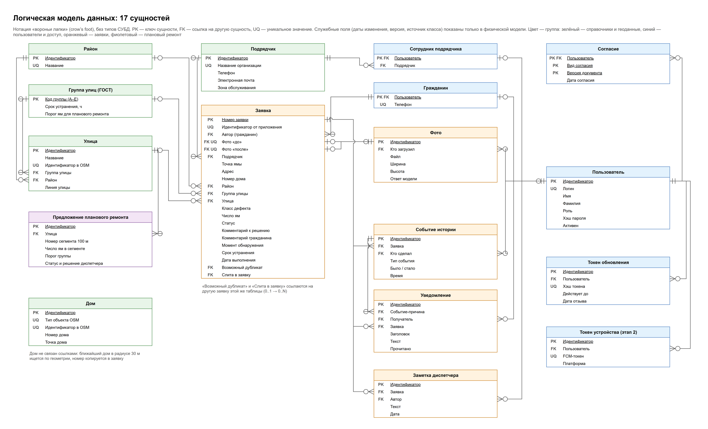
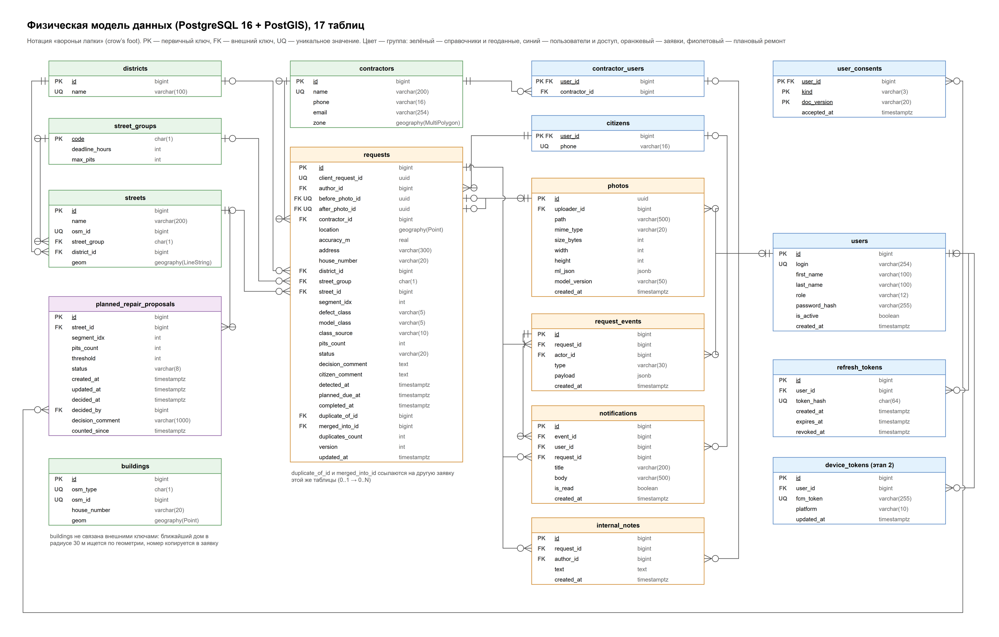

# Схема базы данных

Сервис «Ямочный ремонт»: таблицы, поля, связи, индексы, миграции

Сервис подачи заявок. Ямочный ремонт · ТПУ, 2026

**Версия:** 2.0 от 12.10.2026 (заменяет редакцию от 08.10.2026)

**Автор:** Бердников А. Д., backend-разработчик

**СУБД:** PostgreSQL 16 + PostGIS

**Модели:** Файл Модель_данных_ER.drawio: логическая и физическая

## 1. Общие сведения

### 1.1 Зачем нужна база и что в ней хранится

База данных хранит всё, что нужно, чтобы заявка о яме прошла путь от фото гражданина до подтверждённого ремонта: саму заявку с фото и историей, пользователей и их права, справочники улиц, домов, районов и подрядчиков, а также предложения планового ремонта. Клиенты к базе напрямую не обращаются, только через API бэкенда.

| **Параметр**       | **Значение**                                                                                                                                                                                                                                                                  |
|--------------------|-------------------------------------------------------------------------------------------------------------------------------------------------------------------------------------------------------------------------------------------------------------------------------|
| **СУБД**           | **PostgreSQL 16** с расширением **PostGIS**                                                                                                                                                                                                                                   |
| **Почему она**     | Нужны геозапросы: ближайшая улица и дом в радиусе 30 м, попадание точки в зону подрядчика, дубликаты в радиусе 15 м, участки улиц по 100 м. PostGIS делает это функциями ST_DWithin, ST_Covers, ST_LineLocatePoint с индексами GiST. Плюс строгие транзакции и проверки CHECK |
| **Объём**          | По ПР-9 до 10 000 заявок: строк мало, основной объём занимают файлы фото на диске, а не база                                                                                                                                                                                  |
| **Таблиц**         | 17 в четырёх группах; одна (device_tokens) используется на этапе 2                                                                                                                                                                                                            |
| **Идентификаторы** | bigint с автогенерацией; у фото uuid, чтобы номер нельзя было подобрать                                                                                                                                                                                                       |
| **Время**          | timestamptz, хранится в UTC; томское время показывают клиенты (ЛК-2)                                                                                                                                                                                                          |
| **Геоданные**      | geography, SRID 4326 (широта и долгота WGS 84): расстояния сразу в метрах                                                                                                                                                                                                     |
| **Работа из кода** | SQLAlchemy 2 + GeoAlchemy2; схема меняется только миграциями Alembic (раздел 14)                                                                                                                                                                                              |

### 1.2 Карта таблиц

| **Группа**              | **Таблицы**                                                                     | **Что хранят**                                                                         | **Кто заполняет**                             |
|-------------------------|---------------------------------------------------------------------------------|----------------------------------------------------------------------------------------|-----------------------------------------------|
| Справочники и геоданные | districts, street_groups, streets, buildings, contractors                       | Районы; группы А–Е со сроком и порогом; улицы и дома из OSM; подрядчики с зонами       | Скрипты загрузки при запуске, потом диспетчер |
| Пользователи и доступ   | users, citizens, contractor_users, user_consents, refresh_tokens, device_tokens | Учётные записи; телефон гражданина; привязка сотрудника к подрядчику; согласия; токены | Регистрация, диспетчер, вход                  |
| Заявки                  | requests, photos, request_events, internal_notes, notifications                 | Заявка; фото «до» и «после»; история; заметки; уведомления                             | Гражданин, система, диспетчер, подрядчик      |
| Плановый ремонт         | planned_repair_proposals                                                        | Участки улиц 100 м, где набралось много малых ям                                       | Система                                       |

Центр схемы таблица requests: она ссылается на справочники, автора и фото, а на неё ссылаются история, заметки и уведомления.

### 1.3 Принципы

| **Принцип**                                                                  | **Зачем**                                                               | **Пример**                                                                                  |
|------------------------------------------------------------------------------|-------------------------------------------------------------------------|---------------------------------------------------------------------------------------------|
| **Адрес, дом, район и группа копируются в заявку** на момент подачи (снимок) | Правка справочника не должна менять старые заявки и отчёты (UC-12)      | Улицу перевели из группы Б в А. Старые заявки сохраняют срок по Б, новые получают срок по А |
| **Пользователи не удаляются**, а отключаются (is_active = false)             | Иначе пропадут авторы заявок, история и заметки                         | Сотрудник подрядчика уволился: диспетчер отключает его, все его заявки и события остаются   |
| **Заявка не существует без фото «до»**                                       | Это требование ЧТЗ, и база страхует его даже при ошибке в коде          | before_photo_id NOT NULL: ручной INSERT без фото база отклонит                              |
| **Вычисляемое не хранится**                                                  | Хранимый флаг может разойтись с данными                                 | Просрочка считается из срока и текущего времени, а не хранится флажком (раздел 7)           |
| **Справочник нельзя удалить, если он используется**                          | Все внешние ключи ON DELETE RESTRICT (кроме данных самого пользователя) | Удаление района, на который ссылаются заявки, вернёт ошибку 409                             |

## 2. Связь с требованиями

Какие требования ЧТЗ 0.2 закрываются какими таблицами и полями.

| **Требования**         | **Что нужно хранить**         | **Где**                                                                                     |
|------------------------|-------------------------------|---------------------------------------------------------------------------------------------|
| REQ-002, 015, 016      | Координаты, адрес, фото ямы   | requests.location, accuracy_m, address, house_number; photos                                |
| REQ-003, 004, 043      | Статус и его смены            | requests.status с CHECK; функция change_status()                                            |
| REQ-005, 006           | История заявки                | request_events                                                                              |
| REQ-007, БЗ-4          | Регистрация и согласия        | users, citizens, user_consents                                                              |
| REQ-008, 010, БЗ-2     | Вход, пароли, сессии          | users.login, password_hash; refresh_tokens                                                  |
| REQ-011, 012, 075      | Роли и доступ                 | users.role, citizens, contractor_users                                                      |
| REQ-018, 022, 034, 035 | Ответ модели, класс, число ям | photos.ml_json, model_version; requests.defect_class, model_class, class_source, pits_count |
| REQ-023, 024           | Комментарий и номер заявки    | requests.citizen_comment, requests.id                                                       |
| REQ-031, 032           | Уведомления                   | notifications; device_tokens (этап 2)                                                       |
| REQ-039, 040, 057, 074 | Группа улицы и срок           | streets, street_groups; requests.street_group, planned_due_at                               |
| REQ-041, 042, 058, 064 | Подрядчики и зоны             | contractors.zone; requests.contractor_id                                                    |
| REQ-044, 059           | Дубликаты и слияние           | requests.duplicate_of_id, merged_into_id, duplicates_count                                  |
| REQ-046                | Плановый ремонт               | planned_repair_proposals; requests.segment_idx, pits_count                                  |
| REQ-047                | Контакт заявителя             | citizens.phone                                                                              |
| REQ-060                | Заметки диспетчеров           | internal_notes                                                                              |
| REQ-063                | Подтверждение ремонта         | requests.after_photo_id, completed_at                                                       |
| REQ-073, 077, 078      | Справочники и демо-данные     | districts, streets, buildings, contractors (раздел 10)                                      |
| ФТ-1, ФТ-2             | Формат и разрешение фото      | photos.mime_type, width, height с CHECK                                                     |
| ЛК-2, ХР-1             | Время в UTC, резервные копии  | timestamptz; ежедневный pg_dump (раздел 13)                                                 |

## 3. Модели данных

Обе модели нарисованы в draw.io (файл Модель_данных_ER.drawio, две страницы) в нотации «вороньи лапки». Логическая модель показывает сущности и связи на русском без типов СУБД, её место в Приложении 2 ЧТЗ. Физическая показывает таблицы так, как они создаются в PostgreSQL.



*Рисунок 1. Логическая модель данных*



*Рисунок 2. Физическая модель данных*

**Как читать связи:** у таблицы со ссылкой рисуется «лапка» (много) с кружком (может не быть ни одной строки); у таблицы, на которую ссылаются, черта (ровно одна) или кружок с чертой (ноль или одна, если ссылка необязательна).

> **Какая модель главная**
>
> **Главная физическая модель**: только в ней есть типы и ограничения, по ней пишутся миграции. Логическая выводится из неё (те же 17 сущностей и связи) и в коде не используется.
>
> **Порядок изменений:** миграция Alembic → этот документ → физическая модель → логическая модель → Приложение 2 ЧТЗ. Так модели не разойдутся.

## 4. Таблицы

Обозначения в колонке «Ограничения»: **PK** первичный ключ; **FK →** внешний ключ на таблицу; **UQ** уникальное значение; **NULL** поле может быть пустым (если не написано, поле обязательное, NOT NULL); **DEF** значение по умолчанию; **CHECK** проверка значения; **GiST** пространственный индекс; **CASCADE** строка удаляется вместе с пользователем. Колонка «Откуда значение и когда меняется» отвечает на вопрос, кто и в какой момент пишет поле.

### 4.1 Справочники и геоданные

#### districts: районы

Справочник районов Томска. Заполняется скриптом загрузки улиц, затем его правит диспетчер (UC-12). На район ссылаются улицы и заявки.

| **Атрибут**   | **Поле** | **Тип**      | **Ограничения** | **Откуда значение и когда меняется**                                                                                    |
|---------------|----------|--------------|-----------------|-------------------------------------------------------------------------------------------------------------------------|
| Идентификатор | id       | bigint       | PK              | Генерирует БД при вставке, не меняется                                                                                  |
| Название      | name     | varchar(100) | UQ              | Вводит скрипт загрузки или диспетчер; меняется при переименовании. Заявки хранят ссылку, поэтому покажут новое название |

#### street_groups: группы улиц А–Е

Группы улиц по ГОСТ Р 50597-2017 со сроком устранения и порогом ям для планового ремонта. Заполняется миграцией с начальными данными, сроки и пороги меняет диспетчер (REQ-074). На группу ссылаются улицы и заявки.

| **Атрибут**        | **Поле**       | **Тип** | **Ограничения** | **Откуда значение и когда меняется**                                                                                                                                 |
|--------------------|----------------|---------|-----------------|----------------------------------------------------------------------------------------------------------------------------------------------------------------------|
| Код группы         | code           | char(1) | PK, CHECK А…Е   | Задаётся миграцией, не меняется                                                                                                                                      |
| Срок устранения, ч | deadline_hours | int     | CHECK \> 0      | Начальные значения 24, 72, 120, 168, 240, 288. Меняет диспетчер; новый срок действует для новых заявок и при пересчёте, уже рассчитанные сроки не меняются **\[D\]** |
| Порог ям           | max_pits       | int     | CHECK \> 0      | Начальные значения 2, 2, 10, 16, 42, 104. Меняет диспетчер; применяется при следующем пересчёте участка                                                              |

#### streets: улицы

Улицы демо-территории из OpenStreetMap с группой по ГОСТ и районом. Загружаются скриптом load_streets.py один раз, группа и район берутся из файла street_groups.csv, дальше правит диспетчер. Остальные проезжие дороги Томска, включая дворовые проезды, грузит load_roads.py: группа Е по умолчанию **\[D\]** (В-38), район — по границам районов OSM, у дороги без названия имя «Внутриквартальный проезд». По геометрии автообработка находит улицу заявки.

| **Атрибут**       | **Поле**     | **Тип**                     | **Ограничения**          | **Откуда значение и когда меняется**                                                                               |
|-------------------|--------------|-----------------------------|--------------------------|--------------------------------------------------------------------------------------------------------------------|
| Идентификатор     | id           | bigint                      | PK                       | Генерирует БД                                                                                                      |
| Название          | name         | varchar(200)                |                          | Тег name из OSM; диспетчер может исправить                                                                         |
| Идентификатор OSM | osm_id       | bigint                      | UQ, NULL                 | Номер линии в OSM; пусто у улицы, добавленной вручную. По нему повторная загрузка обновляет строку, а не дублирует |
| Группа улицы      | street_group | char(1)                     | FK → street_groups, NULL | Из street_groups.csv; пусто, пока улица не размечена. Меняет диспетчер; на старые заявки не влияет                 |
| Район             | district_id  | bigint                      | FK → districts           | Из street_groups.csv вместе с группой; меняет диспетчер                                                            |
| Линия улицы       | geom         | geography(LineString, 4326) | GiST                     | Линия из OSM. Если улица в OSM состоит из нескольких кусков, каждый кусок отдельная строка                         |

#### buildings: дома

Дома из OpenStreetMap, у которых есть номер (тег addr:housenumber). Загружаются скриптом load_buildings.py, вручную не правятся. Внешних ключей нет: автообработка ищет ближайший дом в радиусе 30 м и копирует его номер в заявку.

| **Атрибут**       | **Поле**     | **Тип**                | **Ограничения**                   | **Откуда значение и когда меняется**                                                       |
|-------------------|--------------|------------------------|-----------------------------------|--------------------------------------------------------------------------------------------|
| Идентификатор     | id           | bigint                 | PK                                | Генерирует БД                                                                              |
| Тип объекта OSM   | osm_type     | char(1)                | UQ вместе с osm_id, CHECK n, w, r | Точка, контур или связь в OSM. Нужен, потому что номера разных типов в OSM могут совпадать |
| Идентификатор OSM | osm_id       | bigint                 | UQ вместе с osm_type              | Номер объекта в OSM; по паре (тип, номер) повторная загрузка обновляет дом                 |
| Номер дома        | house_number | varchar(20)            |                                   | Значение addr:housenumber как есть: 15, 15А, 15/2. Обновляется при повторной загрузке      |
| Точка дома        | geom         | geography(Point, 4326) | GiST                              | Для точки сама точка, для контура точка внутри контура                                     |

#### contractors: подрядчики

Подрядные организации и их зоны обслуживания. Создаёт и правит диспетчер (REQ-064), для демо создаёт seed_demo.py. На подрядчика ссылаются сотрудники и заявки; по зоне автообработка назначает подрядчика.

| **Атрибут**          | **Поле** | **Тип**                       | **Ограничения** | **Откуда значение и когда меняется**                                                                                                                                                         |
|----------------------|----------|-------------------------------|-----------------|----------------------------------------------------------------------------------------------------------------------------------------------------------------------------------------------|
| Идентификатор        | id       | bigint                        | PK              | Генерирует БД                                                                                                                                                                                |
| Название организации | name     | varchar(200)                  | UQ              | Вводит диспетчер                                                                                                                                                                             |
| Телефон              | phone    | varchar(16)                   |                 | Вводит диспетчер, хранится в формате E.164 (+79131234567)                                                                                                                                    |
| Электронная почта    | email    | varchar(254)                  |                 | Вводит диспетчер                                                                                                                                                                             |
| Зона обслуживания    | zone     | geography(MultiPolygon, 4326) | NULL, GiST      | GeoJSON от диспетчера; API проверяет корректность и что зона не пересекается с чужими **\[D\]**. Пусто: подрядчик не назначается автоматически. Новая зона действует только для новых заявок |
| Активен              | is_active | boolean                      | DEF true        | Диспетчер снимает признак, когда договор расторгнут: подрядчик не участвует в автоназначении и не выбирается вручную, история заявок остаётся (В-7) |

### 4.2 Пользователи и доступ

#### users: пользователи

Учётные записи всех ролей. Гражданин создаёт запись сам при регистрации, сотрудников создаёт диспетчер, первого диспетчера создаёт seed_demo.py. Данные, нужные только одной роли, вынесены в citizens и contractor_users.

| **Атрибут**   | **Поле**      | **Тип**      | **Ограничения** | **Откуда значение и когда меняется**                                                                                       |
|---------------|---------------|--------------|-----------------|----------------------------------------------------------------------------------------------------------------------------|
| Идентификатор | id            | bigint       | PK              | Генерирует БД                                                                                                              |
| Логин         | login         | varchar(254) | UQ              | У гражданина это email (вход по почте, ЧТЗ п. 2.2), у сотрудника логин от диспетчера. Хранится в нижнем регистре **\[D\]** |
| Имя           | first_name    | varchar(100) |                 | Из формы регистрации или от диспетчера; меняет диспетчер                                                                   |
| Фамилия       | last_name     | varchar(100) |                 | То же                                                                                                                      |
| Роль          | role          | varchar(12)  | CHECK           | citizen, dispatcher или contractor; задаётся при создании и не меняется **\[D\]**                                          |
| Хэш пароля    | password_hash | varchar(255) |                 | argon2 от пароля, сам пароль не хранится. Меняется при сбросе пароля диспетчером                                           |
| Активен       | is_active     | boolean      | DEF true        | Диспетчер отключает пользователя вместо удаления; при отключении отзываются все его refresh-токены                         |
| Дата создания | created_at    | timestamptz  | DEF now()       | Ставит БД, не меняется                                                                                                     |

#### citizens: граждане

Профиль гражданина: телефон для связи. Создаётся в одной транзакции с пользователем при регистрации. На эту таблицу ссылается автор заявки, поэтому сотрудник не может подать заявку.

| **Атрибут**  | **Поле** | **Тип**     | **Ограничения**          | **Откуда значение и когда меняется**                                                                       |
|--------------|----------|-------------|--------------------------|------------------------------------------------------------------------------------------------------------|
| Пользователь | user_id  | bigint      | PK, FK → users (CASCADE) | Равен users.id; триггер check_user_role проверяет, что роль citizen                                        |
| Телефон      | phone    | varchar(16) | UQ                       | Из формы регистрации, приводится к E.164; не подтверждается. Видит диспетчер (REQ-047), подрядчик не видит |

#### contractor_users: сотрудники подрядчиков

Привязка пользователя с ролью contractor к организации. Создаётся вместе с пользователем. По ней API решает, какие заявки видит сотрудник.

| **Атрибут**  | **Поле**      | **Тип** | **Ограничения**          | **Откуда значение и когда меняется**                      |
|--------------|---------------|---------|--------------------------|-----------------------------------------------------------|
| Пользователь | user_id       | bigint  | PK, FK → users (CASCADE) | Равен users.id; триггер проверяет, что роль contractor    |
| Подрядчик    | contractor_id | bigint  | FK → contractors         | Выбирает диспетчер при создании сотрудника; может сменить |

#### user_consents: согласия

Согласия гражданина на обработку ПДн и на геолокацию (БЗ-4, REQ-007). Две строки появляются при регистрации, новая строка при новой версии текста. Строки не меняются и не удаляются.

| **Атрибут**      | **Поле**    | **Тип**     | **Ограничения**          | **Откуда значение и когда меняется**                                 |
|------------------|-------------|-------------|--------------------------|----------------------------------------------------------------------|
| Пользователь     | user_id     | bigint      | PK, FK → users (CASCADE) | Из регистрации                                                       |
| Вид согласия     | kind        | varchar(3)  | PK, CHECK pd, geo        | pd — персональные данные, geo — геолокация                           |
| Версия документа | doc_version | varchar(20) | PK                       | Версия текста согласия, которую видел пользователь (из настроек API) |
| Дата согласия    | accepted_at | timestamptz | DEF now()                | Ставит БД                                                            |

#### refresh_tokens: токены обновления

Выданные refresh-токены. Строка появляется при входе и при каждом обновлении (ротация). Нужна, чтобы отзывать сессии и распознать повторное предъявление украденного токена.

| **Атрибут**   | **Поле**   | **Тип**     | **Ограничения**      | **Откуда значение и когда меняется**                                                                            |
|---------------|------------|-------------|----------------------|-----------------------------------------------------------------------------------------------------------------|
| Идентификатор | id         | bigint      | PK                   | Генерирует БД                                                                                                   |
| Пользователь  | user_id    | bigint      | FK → users (CASCADE) | Из входа                                                                                                        |
| Хэш токена    | token_hash | char(64)    | UQ                   | SHA-256 от токена; сам токен знает только клиент                                                                |
| Дата выдачи   | created_at | timestamptz | DEF now()            | Ставит БД                                                                                                       |
| Действует до  | expires_at | timestamptz |                      | Дата выдачи + 14 дней                                                                                           |
| Дата отзыва   | revoked_at | timestamptz | NULL                 | Ставится при выходе, ротации, сбросе пароля, отключении пользователя. Просроченные строки удаляет ночная задача |

#### device_tokens: токены устройств (этап 2)

FCM-токены телефонов для push-уведомлений, этап 2. Приложение присылает токен после входа и при его смене. Таблица заложена сразу, чтобы FCM подключился без изменения схемы.

| **Атрибут**     | **Поле**   | **Тип**      | **Ограничения**      | **Откуда значение и когда меняется**                      |
|-----------------|------------|--------------|----------------------|-----------------------------------------------------------|
| Идентификатор   | id         | bigint       | PK                   | Генерирует БД                                             |
| Пользователь    | user_id    | bigint       | FK → users (CASCADE) | Из токена входа                                           |
| FCM-токен       | fcm_token  | varchar(255) | UQ                   | Выдаёт Firebase на телефоне                               |
| Платформа       | platform   | varchar(10)  |                      | android                                                   |
| Дата обновления | updated_at | timestamptz  | DEF now()            | Обновляет триггер, когда приложение снова присылает токен |

### 4.3 Заявки

#### requests: заявки

Главная таблица. Заявку создаёт гражданин, в той же транзакции её дополняет автообработка, дальше меняют диспетчер (статус, класс, группа, подрядчик, слияние) и подрядчик (выполнение). На заявку ссылаются история, заметки и уведомления.

| **Атрибут**                 | **Поле**          | **Тип**                | **Ограничения**          | **Откуда значение и когда меняется**                                                                      |
|-----------------------------|-------------------|------------------------|--------------------------|-----------------------------------------------------------------------------------------------------------|
| Номер заявки                | id                | bigint                 | PK                       | Генерирует БД; этот номер видит гражданин (REQ-024)                                                       |
| Идентификатор от приложения | client_request_id | uuid                   | UQ вместе с author_id    | Генерирует приложение для каждой новой заявки; повтор с тем же значением вернёт ту же заявку. Не меняется |
| Автор                       | author_id         | bigint                 | FK → citizens            | Из токена гражданина. Не меняется                                                                         |
| Фото «до»                   | before_photo_id   | uuid                   | FK → photos, UQ          | photo_id из анализа фото; без него заявка не создаётся. Не меняется                                       |
| Фото «после»                | after_photo_id    | uuid                   | FK → photos, UQ, NULL    | Заполняется, когда подрядчик завершает работу; у слитой заявки пусто                                      |
| Точка ямы                   | location          | geography(Point, 4326) | GiST                     | Координаты от приложения: GPS или точка на карте (REQ-015, 025). Не меняется                              |
| Точность GPS, м             | accuracy_m        | real                   | NULL                     | От телефона; пусто, если точку выбрали на карте                                                           |
| Адрес                       | address           | varchar(300)           | NULL                     | Собирает автообработка: «улица, дом, район». Снимок: правка справочников его не меняет                    |
| Номер дома                  | house_number      | varchar(20)            | NULL                     | Номер ближайшего дома в радиусе 30 м. Снимок                                                              |
| Район                       | district_id       | bigint                 | FK → districts, NULL     | Район найденной улицы. Снимок                                                                             |
| Группа улицы                | street_group      | char(1)                | FK → street_groups, NULL | Группа найденной улицы (снимок). Диспетчер может изменить (REQ-057), тогда пересчитывается срок           |
| Улица                       | street_id         | bigint                 | FK → streets, NULL       | Ближайшая улица в радиусе 30 м; пусто, если не найдена                                                    |
| Участок улицы               | segment_idx       | int                    | NULL                     | Номер участка 100 м; считается вместе с улицей. Хранится, чтобы по нему был индекс для планового ремонта  |
| Класс дефекта               | defect_class      | varchar(5)             | CHECK big, small         | Итоговый класс: от модели, от гражданина (если модель не ответила) или от диспетчера (REQ-056)            |
| Класс от модели             | model_class       | varchar(5)             | NULL, CHECK              | Ответ модели; пусто, если модель не ответила. Не меняется                                                 |
| Источник класса             | class_source      | varchar(10)            | CHECK                    | model, citizen или dispatcher; меняется вместе с классом                                                  |
| Количество ям               | pits_count        | int                    | DEF 1, CHECK ≥ 1         | От модели; 1, если класс выбран вручную                                                                   |
| Статус                      | status            | varchar(20)            | DEF on_review, CHECK     | Меняет только функция change_status() (раздел 11)                                                         |
| Причина отклонения          | reject_reason     | varchar(10)            | NULL, CHECK              | small_pit, not_a_pit, duplicate или other; выбирает диспетчер при «Отклонено». В плановый ремонт идут только small_pit (В-2) |
| Комментарий к решению       | decision_comment  | text                   | NULL                     | Пишет диспетчер: причина отклонения (обязательна) или что уточняется                                      |
| Комментарий гражданина      | citizen_comment   | text                   | NULL                     | Из формы подачи (REQ-023). Не меняется                                                                    |
| Момент обнаружения          | detected_at       | timestamptz            | DEF now()                | Время регистрации заявки; по ГОСТ от него считается срок. Не меняется                                     |
| Срок устранения             | planned_due_at    | timestamptz            | NULL                     | Момент обнаружения + срок группы. Пересчитывается при смене группы или класса; пусто, если группы нет     |
| Дата выполнения             | completed_at      | timestamptz            | NULL                     | Ставится при переходе в «Выполнено»                                                                       |
| Подрядчик                   | contractor_id     | bigint                 | FK → contractors, NULL   | Автообработка по зоне или диспетчер вручную (REQ-058)                                                     |
| Возможный дубликат          | duplicate_of_id   | bigint                 | FK → requests, NULL      | Автообработка: активная заявка того же класса в радиусе 15 м. Диспетчер может снять пометку               |
| Слита в заявку              | merged_into_id    | bigint                 | FK → requests, NULL      | Основная заявка после слияния (REQ-059); с этого момента статус повторяет основную                        |
| Число дубликатов            | duplicates_count  | int                    | DEF 0                    | Сколько заявок слито в эту; меняется только при слиянии. Нужно для приоритета                             |
| Версия                      | version           | int                    | DEF 1                    | +1 при каждом изменении; клиент присылает её в действиях диспетчера (защита от одновременной правки)      |
| Дата изменения              | updated_at        | timestamptz            | DEF now()                | Ставит триггер set_updated_at                                                                             |

**CHECK:** заявка не ссылается сама на себя (duplicate_of_id \<\> id, merged_into_id \<\> id); в статусе «В работе» заполнен contractor_id; в статусе «Выполнено» заполнены after_photo_id и completed_at; в статусах «Принято», «В работе», «Выполнено» заполнен planned_due_at, то есть без группы улицы заявку не принять (В-3). Три последних правила не действуют для слитых заявок: их статус повторяет основную, а фото «после» берётся у неё.

**Не меняются после создания** (триггер forbid_requests_immutable): author_id, client_request_id, detected_at, before_photo_id.

#### photos: фотографии

Сведения о фото «до» и «после»; сам файл лежит на диске. Строку создаёт анализ фото (фото «до») или завершение работы подрядчиком (фото «после»). Чьё это фото и какое, определяет поле заявки, которое на него ссылается.

| **Атрибут**   | **Поле**      | **Тип**      | **Ограничения**             | **Откуда значение и когда меняется**                                    |
|---------------|---------------|--------------|-----------------------------|-------------------------------------------------------------------------|
| Идентификатор | id            | uuid         | PK                          | Генерирует API; входит в имя файла, поэтому номер фото нельзя подобрать |
| Кто загрузил  | uploader_id   | bigint       | FK → users                  | Из токена: гражданин или сотрудник подрядчика                           |
| Путь к файлу  | path          | varchar(500) |                             | Путь внутри /data/photos; задаёт API                                    |
| Формат        | mime_type     | varchar(20)  | CHECK image/jpeg, image/png | Определяет Pillow по содержимому файла, а не по расширению (ФТ-1)       |
| Размер, байт  | size_bytes    | int          |                             | Размер файла                                                            |
| Ширина, px    | width         | int          | CHECK (см. ниже)            | Из Pillow                                                               |
| Высота, px    | height        | int          | CHECK (см. ниже)            | Из Pillow                                                               |
| Ответ модели  | ml_json       | jsonb        | NULL                        | Полный ответ ML-сервиса; пусто у фото «после» и если модель не ответила |
| Версия модели | model_version | varchar(50)  | NULL                        | Из ответа ML-сервиса                                                    |
| Дата загрузки | created_at    | timestamptz  | DEF now()                   | По ней ночная задача удаляет фото без заявки старше 24 часов            |

**CHECK на разрешение (ФТ-2):** greatest(width, height) ≥ 1280 AND least(width, height) ≥ 720. Так проходят и горизонтальные, и вертикальные снимки; прежняя проверка width ≥ 1280 AND height ≥ 720 отклоняла бы вертикальное фото 720×1280.

#### request_events: история заявки

История заявки (REQ-005, 006): одна строка на каждое значимое действие. Пишет приложение в той же транзакции, что и само изменение. Строки не меняются и не удаляются.

| **Атрибут**   | **Поле**   | **Тип**     | **Ограничения**  | **Откуда значение и когда меняется**                                                       |
|---------------|------------|-------------|------------------|--------------------------------------------------------------------------------------------|
| Идентификатор | id         | bigint      | PK               | Генерирует БД                                                                              |
| Заявка        | request_id | bigint      | FK → requests    | Заявка, с которой произошло событие                                                        |
| Кто сделал    | actor_id   | bigint      | FK → users, NULL | Из токена; пусто для действий системы (автообработка, автоматический переход в «В работе») |
| Тип события   | type       | varchar(30) | CHECK            | Список в разделе 6                                                                         |
| Подробности   | payload    | jsonb       | DEF '{}'         | Было и стало, комментарий; например {"from": "Принято", "to": "В работе"}                  |
| Время         | created_at | timestamptz | DEF now()        | Ставит БД                                                                                  |

#### internal_notes: заметки диспетчеров

Внутренние заметки диспетчеров к заявке (REQ-060). Добавляет диспетчер, гражданин и подрядчик их не видят. Заметки не редактируются и не удаляются **\[D\]**.

| **Атрибут**   | **Поле**   | **Тип**     | **Ограничения** | **Откуда значение и когда меняется** |
|---------------|------------|-------------|-----------------|--------------------------------------|
| Идентификатор | id         | bigint      | PK              | Генерирует БД                        |
| Заявка        | request_id | bigint      | FK → requests   | Из адреса запроса                    |
| Автор         | author_id  | bigint      | FK → users      | Диспетчер из токена                  |
| Текст         | text       | text        |                 | Вводит диспетчер                     |
| Дата создания | created_at | timestamptz | DEF now()       | Ставит БД                            |

#### notifications: уведомления

Уведомления гражданину о смене статуса его заявки (REQ-031, 032). Создаются в транзакции смены статуса, по одному на получателя и событие. Приложение забирает их опросом.

| **Атрибут**   | **Поле**   | **Тип**      | **Ограничения**     | **Откуда значение и когда меняется**                |
|---------------|------------|--------------|---------------------|-----------------------------------------------------|
| Идентификатор | id         | bigint       | PK                  | Генерирует БД                                       |
| Получатель    | user_id    | bigint       | FK → users          | Автор заявки или автор слитой в неё заявки          |
| Заявка        | request_id | bigint       | FK → requests       | По ней приложение открывает детали заявки (REQ-032) |
| Событие       | event_id   | bigint       | FK → request_events | Смена статуса, из-за которой создано уведомление    |
| Заголовок     | title      | varchar(200) |                     | Формирует API, например «Заявка № 12»               |
| Текст         | body       | varchar(500) |                     | Формирует API, например «Статус изменён: В работе»  |
| Прочитано     | is_read    | boolean      | DEF false           | Ставит приложение через /me/notifications/read      |
| Дата создания | created_at | timestamptz  | DEF now()           | По ней приложение запрашивает новые уведомления     |

**UQ (user_id, event_id):** по одному событию пользователь получает одно уведомление.

### 4.4 Плановый ремонт

#### planned_repair_proposals: предложения планового ремонта

Предложения планового ремонта (REQ-046, UC-10): участок улицы 100 м, где отклонённых малых ям больше порога группы. Создаёт и обновляет только система при пересчёте участка, диспетчер просматривает. Состав (какие заявки) не хранится, он считается запросом.

| **Атрибут**    | **Поле**    | **Тип**     | **Ограничения**                       | **Откуда значение и когда меняется**                                     |
|----------------|-------------|-------------|---------------------------------------|--------------------------------------------------------------------------|
| Идентификатор  | id          | bigint      | PK                                    | Генерирует БД                                                            |
| Улица          | street_id   | bigint      | FK → streets, UQ вместе с segment_idx | Улица участка                                                            |
| Участок        | segment_idx | int         | CHECK ≥ 0                             | Номер участка 100 м                                                      |
| Число ям       | pits_count  | int         |                                       | Сумма ям участка на момент последнего пересчёта                          |
| Порог          | threshold   | int         |                                       | Порог группы улицы на момент пересчёта                                   |
| Статус         | status      | varchar(6)  | CHECK open, closed                    | open, когда сумма больше порога; closed, когда стала не больше **\[D\]** |
| Дата создания  | created_at  | timestamptz | DEF now()                             | Ставит БД                                                                |
| Дата пересчёта | updated_at  | timestamptz | DEF now()                             | Ставит триггер set_updated_at                                            |

## 5. Связи

26 связей: 22 «один ко многим» (из них 2 у заявки на саму себя) и 4 «один к одному». Связей «многие ко многим» нет. Таблица buildings внешних ключей не имеет.

| **№** | **Родитель**   | **Потомок**              | **Поле**        | **Тип** | **Что означает**                                         |
|-------|----------------|--------------------------|-----------------|---------|----------------------------------------------------------|
| 1     | districts      | streets                  | district_id     | 1 : N   | В районе много улиц                                      |
| 2     | street_groups  | streets                  | street_group    | 1 : N   | Улица относится к группе (пока не размечена, без группы) |
| 3     | districts      | requests                 | district_id     | 1 : N   | Район заявки на момент подачи                            |
| 4     | street_groups  | requests                 | street_group    | 1 : N   | Группа заявки на момент подачи                           |
| 5     | streets        | requests                 | street_id       | 1 : N   | Яма находится на улице                                   |
| 6     | contractors    | contractor_users         | contractor_id   | 1 : N   | В организации несколько сотрудников                      |
| 7     | contractors    | requests                 | contractor_id   | 1 : N   | Подрядчик выполняет заявки                               |
| 8     | users          | citizens                 | user_id         | 1 : 1   | Профиль пользователя с ролью гражданин                   |
| 9     | users          | contractor_users         | user_id         | 1 : 1   | Профиль пользователя с ролью подрядчик                   |
| 10    | citizens       | requests                 | author_id       | 1 : N   | Гражданин подаёт заявки                                  |
| 11    | users          | user_consents            | user_id         | 1 : N   | Согласия пользователя                                    |
| 12    | users          | refresh_tokens           | user_id         | 1 : N   | Сессии пользователя                                      |
| 13    | users          | device_tokens            | user_id         | 1 : N   | Телефоны пользователя (этап 2)                           |
| 14    | users          | photos                   | uploader_id     | 1 : N   | Кто загрузил фото                                        |
| 15    | photos         | requests                 | before_photo_id | 1 : 1   | Фото «до» заявки                                         |
| 16    | photos         | requests                 | after_photo_id  | 1 : 1   | Фото «после» заявки                                      |
| 17    | requests       | request_events           | request_id      | 1 : N   | История заявки                                           |
| 18    | users          | request_events           | actor_id        | 1 : N   | Кто совершил действие (пусто у системы)                  |
| 19    | requests       | internal_notes           | request_id      | 1 : N   | Заметки к заявке                                         |
| 20    | users          | internal_notes           | author_id       | 1 : N   | Автор заметки                                            |
| 21    | users          | notifications            | user_id         | 1 : N   | Получатель уведомления                                   |
| 22    | requests       | notifications            | request_id      | 1 : N   | Уведомления по заявке                                    |
| 23    | request_events | notifications            | event_id        | 1 : N   | Событие, вызвавшее уведомление                           |
| 24    | streets        | planned_repair_proposals | street_id       | 1 : N   | Предложения по участкам улицы                            |
| 25    | requests       | requests                 | duplicate_of_id | 1 : N   | Заявка похожа на другую                                  |
| 26    | requests       | requests                 | merged_into_id  | 1 : N   | Заявка слита в основную                                  |

## 6. Допустимые значения

| **Поле**                               | **Значения**                                                                                                                     |
|----------------------------------------|----------------------------------------------------------------------------------------------------------------------------------|
| **users.role**                         | citizen (гражданин), dispatcher (диспетчер), contractor (подрядчик)                                                              |
| **requests.status**                    | on_review (На проверке), accepted (Принято), rejected (Отклонено), needs_clarification (Требует уточнения), in_progress (В работе), done (Выполнено). Подписи — app/core/statuses.py (В-37) |
| **requests.defect_class, model_class** | big (большая яма), small (маленькая яма)                                                                                         |
| **requests.class_source**              | model (модель), citizen (гражданин), dispatcher (диспетчер)                                                                      |
| **request_events.type**                | created, processed, status_changed, class_changed, group_changed, contractor_changed, merged, duplicate_flag_removed, note_added |
| **user_consents.kind**                 | pd (персональные данные), geo (геолокация)                                                                                       |
| **buildings.osm_type**                 | n (точка), w (линия или контур), r (связь)                                                                                       |
| **photos.mime_type**                   | image/jpeg, image/png                                                                                                            |
| **street_groups.code**                 | А, Б, В, Г, Д, Е                                                                                                                 |
| **planned_repair_proposals.status**    | open (открыто), closed (закрыто)                                                                                                 |

## 7. Что вычисляется, а не хранится

Эти значения видны пользователям, но в базе их нет: они считаются при каждом запросе из хранимых полей. Формулы совпадают с документом «Бэкенд: архитектура», раздел 9.5.

| **Что**                    | **Формула**                                                                                     | **Из каких полей**                                                        | **Почему не хранится**                                                                                   |
|----------------------------|-------------------------------------------------------------------------------------------------|---------------------------------------------------------------------------|----------------------------------------------------------------------------------------------------------|
| Просрочка                  | planned_due_at \< now() и статус «Принято» или «В работе»                                       | planned_due_at, status                                                    | Зависит от текущего времени: флаг пришлось бы обновлять по расписанию                                    |
| Подлежит устранению        | defect_class = big                                                                              | defect_class                                                              | Полностью определяется классом, отдельное поле могло бы с ним разойтись                                  |
| Рекомендация диспетчеру    | big → «Принято»; small → «Отклонено» с текстом про плановый ремонт                              | defect_class                                                              | То же; при смене класса рекомендация меняется сама                                                       |
| Приоритет в панели         | Сортировка: big выше → duplicates_count по убыванию → группа А→Е → detected_at → planned_due_at (В-11) | defect_class, duplicates_count, street_group, planned_due_at, detected_at | Это порядок заявок относительно друг друга, а не свойство одной заявки                                   |
| Нужна группа               | street_group IS NULL                                                                            | street_group                                                              | Простая проверка пустого поля                                                                            |
| Нужен подрядчик            | contractor_id IS NULL                                                                           | contractor_id                                                             | То же                                                                                                    |
| Сумма ям участка           | Число заявок участка со статусом «Отклонено», reject_reason = small_pit, классом small, без merged_into_id (В-2, В-15) | street_id, segment_idx, status, defect_class, pits_count, merged_into_id  | Меняется при любом решении по заявкам участка. В предложении хранится только снимок последнего пересчёта |
| Состав предложения         | Тот же запрос, что и для суммы                                                                  | те же                                                                     | Всегда совпадает с текущими заявками                                                                     |
| Фото «после» слитой заявки | Фото основной заявки через merged_into_id                                                       | merged_into_id, after_photo_id                                            | Не дублировать одно фото в нескольких заявках                                                            |
| Выполнено в срок           | completed_at ≤ planned_due_at                                                                   | completed_at, planned_due_at                                              | Нужно только в отчётах                                                                                   |
| Среднее время устранения   | Среднее completed_at − detected_at по выполненным                                               | completed_at, detected_at                                                 | Агрегат за выбранный период                                                                              |

## 8. Индексы

Первичные ключи и UNIQUE индексируются автоматически. Ниже все индексы, которые создаёт миграция, и запросы, ради которых они нужны.

| **Таблица**              | **Индекс**                                                                               | **Вид**            | **Для чего**                                           |
|--------------------------|------------------------------------------------------------------------------------------|--------------------|--------------------------------------------------------|
| requests                 | location                                                                                 | GiST               | Дубликаты в радиусе 15 м, карта по видимой области     |
| requests                 | (status, detected_at)                                                                    | B-tree             | Списки по статусу и дате                               |
| requests                 | (detected_at) WHERE status = 'on_review'                                               | частичный          | Панель «Требует решения»                               |
| requests                 | (contractor_id, status)                                                                  | B-tree             | Заявки подрядчика                                      |
| requests                 | (author_id, detected_at DESC)                                                            | B-tree             | «Мои заявки» гражданина                                |
| requests                 | (planned_due_at) WHERE status IN ('accepted', 'in_progress')                                 | частичный          | Просроченные заявки                                    |
| requests                 | (merged_into_id)                                                                         | B-tree             | Слитые заявки основной, синхронизация статуса          |
| requests                 | (street_id, segment_idx)                                                                 | B-tree             | Пересчёт участка и состав предложения                  |
| requests                 | UNIQUE (author_id, client_request_id), UNIQUE (before_photo_id), UNIQUE (after_photo_id) | уникальные         | Защита от повторной отправки; одно фото на одну заявку |
| streets                  | geom                                                                                     | GiST               | Ближайшая улица                                        |
| buildings                | geom; UNIQUE (osm_type, osm_id)                                                          | GiST; уникальный   | Ближайший дом; повторная загрузка без дублей           |
| contractors              | zone                                                                                     | GiST               | Подрядчик по точке                                     |
| contractor_users         | (contractor_id)                                                                          | B-tree             | Сотрудники подрядчика                                  |
| photos                   | (created_at)                                                                             | B-tree             | Ночное удаление фото без заявки                        |
| request_events           | (request_id, created_at)                                                                 | B-tree             | История заявки по порядку                              |
| notifications            | (user_id, created_at DESC); UNIQUE (user_id, event_id)                                   | B-tree; уникальный | Опрос уведомлений; одно уведомление на событие         |
| refresh_tokens           | (user_id)                                                                                | B-tree             | Отзыв всех токенов пользователя                        |
| planned_repair_proposals | UNIQUE (street_id, segment_idx)                                                          | уникальный         | Одно предложение на участок                            |

## 9. Триггеры

Триггеров три, и каждый защищает то, что нельзя доверить только коду. Остальная логика (история, уведомления, счётчик дубликатов, пересчёт участков) выполняется приложением в той же транзакции: её нужно тестировать и менять вместе с кодом.

| **Триггер**               | **Таблицы**                                       | **Когда**             | **Что делает**                                                                              |
|---------------------------|---------------------------------------------------|-----------------------|---------------------------------------------------------------------------------------------|
| set_updated_at            | requests, planned_repair_proposals, device_tokens | BEFORE UPDATE         | Ставит updated_at = now()                                                                   |
| check_user_role           | citizens, contractor_users                        | BEFORE INSERT, UPDATE | Проверяет роль в users: citizen для citizens, contractor для contractor_users; иначе ошибка |
| forbid_requests_immutable | requests                                          | BEFORE UPDATE         | Запрещает менять author_id, client_request_id, detected_at, before_photo_id                 |

Не триггеры: проверка версии (делается в самом запросе UPDATE … WHERE id = :id AND version = :v) и ночная чистка фото и токенов (задача приложения).

## 10. Справочники и начальные данные

| **Группа** | **Срок устранения** | **Порог ям для планового ремонта** |
|------------|---------------------|------------------------------------|
| А          | 24 ч (1 сутки)      | 2                                  |
| Б          | 72 ч (3 суток)      | 2                                  |
| В          | 120 ч (5 суток)     | 10                                 |
| Г          | 168 ч (7 суток)     | 16                                 |
| Д          | 240 ч (10 суток)    | 42                                 |
| Е          | 288 ч (12 суток)    | 104                                |

| **Что**                                           | **Откуда**                                                                                                                        | **Чем загружается**        |
|---------------------------------------------------|-----------------------------------------------------------------------------------------------------------------------------------|----------------------------|
| Группы улиц А–Е                                   | Таблица выше (REQ-040, 046)                                                                                                       | Миграция Alembic с данными |
| Улицы демо-территории                             | OSM через Overpass: пр. Ленина, Комсомольский пр., ул. Лыткина, ул. Котовского, ул. Учебная, Богашёвский тракт и другие (REQ-077) | scripts/load_streets.py    |
| Группа и район каждой улицы                       | Файл street_groups.csv, размечает команда; Богашёвский тракт = группа А                                                           | load_streets.py            |
| Районы                                            | Из street_groups.csv                                                                                                              | load_streets.py            |
| Дома                                              | OSM: объекты с тегом addr:housenumber на демо-территории                                                                          | scripts/load_buildings.py  |
| Не меньше 3 подрядчиков с зонами                  | GeoJSON, зоны покрывают демо-территорию (REQ-078)                                                                                 | scripts/seed_demo.py       |
| Первый диспетчер, демо-подрядчик и демо-гражданин | Создаются скриптом: через API первого диспетчера создать некому                                                                   | seed_demo.py               |
| 50–100 демо-заявок                                | Для проверки приоритета, отчётов и карты                                                                                          | seed_demo.py — в PR 2-5: заявки создаются через сервис, чтобы их заполняла автообработка |

Скрипты загрузки можно запускать повторно: улицы и дома обновляются по идентификатору OSM, а не дублируются.

## 11. Жизненный цикл заявки в базе

Диаграмма статусов (UML State) приведена в документе «Бэкенд: архитектура», раздел 9.1. Здесь показано, какие поля и таблицы меняются на каждом шаге. Все шаги, кроме анализа фото, выполняются одной транзакцией.

| **Шаг**                  | **Статус после**           | **Что меняется в requests**                                                                     | **Другие таблицы**                                                             |
|--------------------------|----------------------------|-------------------------------------------------------------------------------------------------|--------------------------------------------------------------------------------|
| Анализ фото              | — (заявки ещё нет)         | —                                                                                               | photos: новая строка без заявки                                                |
| Создание и автообработка | На проверке                | Все поля подачи; улица, дом, адрес, район, группа, участок, срок, подрядчик, возможный дубликат | request_events: created, processed                                             |
| Принять                  | Принято или сразу В работе | status, version                                                                                 | request_events: status_changed (1 или 2); notifications                        |
| Отклонить                | Отклонено                  | status, decision_comment (обязателен)                                                           | request_events, notifications; для малой ямы пересчёт planned_repair_proposals |
| Требует уточнения        | Требует уточнения          | status, decision_comment                                                                        | request_events, notifications                                                  |
| Сменить класс            | не меняется                | defect_class, class_source = dispatcher, planned_due_at                                         | request_events: class_changed; пересчёт участка                                |
| Сменить группу           | не меняется                | street_group, planned_due_at                                                                    | request_events: group_changed                                                  |
| Назначить подрядчика     | из «Принято» в «В работе»  | contractor_id, status                                                                           | request_events: contractor_changed, status_changed; notifications              |
| Слить с основной         | как у основной             | merged_into_id; у основной duplicates_count + 1                                                 | request_events: merged в обе заявки                                            |
| Выполнить                | Выполнено                  | after_photo_id, completed_at, status                                                            | photos: фото «после»; request_events; notifications                            |

## 12. Сценарии заполнения данных

| **Сценарий**                   | **Что записывается**                                                                                                                                                                                                                         | **Таблицы**                                     |
|--------------------------------|----------------------------------------------------------------------------------------------------------------------------------------------------------------------------------------------------------------------------------------------|-------------------------------------------------|
| Регистрация гражданина         | Пользователь с ролью citizen, телефон, два согласия; всё одной транзакцией                                                                                                                                                                   | users, citizens, user_consents                  |
| Вход и выход                   | При входе новый refresh-токен. При выходе, ротации, сбросе пароля или отключении ставится дата отзыва. Строка не удаляется: если пришёл отозванный токен, им воспользовались дважды, значит он украден, и отзываются все токены пользователя | refresh_tokens                                  |
| Гражданин загружает фото       | Файл на диске; размеры, формат, ответ модели и её версия. Пока заявки нет, фото ни к чему не привязано                                                                                                                                       | photos                                          |
| Гражданин подаёт заявку        | Автор, фото «до», точка, комментарий, статус «На проверке», затем результаты автообработки (адрес, район, группа, срок, подрядчик, дубликат)                                                                                                 | requests, request_events                        |
| Модель недоступна              | model_class пустой, класс выбирает гражданин, class_source = citizen                                                                                                                                                                         | requests                                        |
| Найдена похожая заявка         | duplicate_of_id. При слиянии merged_into_id, у основной растёт duplicates_count, событие merged                                                                                                                                              | requests, request_events                        |
| Диспетчер принимает заявку     | Статус «Принято», событие и уведомление; если подрядчик назначен, сразу «В работе»                                                                                                                                                           | requests, request_events, notifications         |
| Диспетчер назначает подрядчика | contractor_id; если заявка «Принято», статус «В работе» (без подрядчика CHECK не даст)                                                                                                                                                       | requests, request_events                        |
| Диспетчер отклоняет малую яму  | Причина и статус «Отклонено»; пересчитывается сумма ям участка                                                                                                                                                                               | requests, planned_repair_proposals              |
| На участке набрался порог      | Создаётся или обновляется предложение: улица, участок, число ям, порог, статус open                                                                                                                                                          | planned_repair_proposals                        |
| Подрядчик выполнил работу      | Фото «после»; after_photo_id, completed_at, статус «Выполнено»; уведомление гражданину                                                                                                                                                       | photos, requests, request_events, notifications |
| Заметка диспетчера             | Текст, автор, дата; гражданин её не видит                                                                                                                                                                                                    | internal_notes                                  |
| Ночная чистка                  | Удаляются фото без заявки старше 24 часов (с файлом) и просроченные refresh-токены                                                                                                                                                           | photos, refresh_tokens                          |

## 13. Безопасность и персональные данные

| **Данные**               | **Где хранятся**                                     | **Кто видит**                                               |
|--------------------------|------------------------------------------------------|-------------------------------------------------------------|
| Имя и фамилия            | users.first_name, last_name                          | Сам пользователь, диспетчер                                 |
| Email (логин гражданина) | users.login                                          | Сам пользователь, диспетчер                                 |
| Телефон гражданина       | citizens.phone                                       | Сам гражданин и диспетчер (REQ-047); подрядчику не отдаётся |
| Место ямы и фото         | requests.location, photos, файлы на диске            | Автор, диспетчер, назначенный подрядчик                     |
| Факт и версия согласий   | user_consents                                        | Система, диспетчер                                          |
| Пароль                   | Не хранится; только хэш argon2 в users.password_hash | Никто                                                       |
| Refresh-токен            | Не хранится; только хэш SHA-256                      | Никто                                                       |

- **Доступ:** база открыта только внутри сети Docker, наружу не публикуется; клиенты работают через API, который фильтрует данные по роли и владельцу.

- **Ответы по ролям:** подрядчику и гражданину отдаются разные схемы ответа, поэтому телефон заявителя не попадёт к подрядчику даже по ошибке.

- **Резервные копии** (ХР-1) содержат персональные данные: хранятся только 2 последние, на той же машине, вне репозитория.

- **Логи** не содержат паролей, токенов и телефонов.

- **Удаление аккаунта и отзыв согласия** в ЧТЗ не описаны; предлагается обезличивание (имя, email и телефон заменяются, заявки остаются). Это вопрос В-25 в документе «Вопросы и спорные ситуации».

## 14. Миграции

Схема создаётся и меняется только миграциями **Alembic**. Чтобы Alembic правильно работал с типами PostGIS, подключаются помощники **GeoAlchemy2** (geoalchemy2.alembic_helpers): без них автогенерация не импортирует геотипы, путается в GiST-индексах и пытается удалить служебные таблицы PostGIS.

```python
# migrations/env.py
from geoalchemy2 import alembic_helpers

context.configure(
    connection=connection,
    target_metadata=Base.metadata,
    include_object=alembic_helpers.include_object,
    process_revision_directives=alembic_helpers.writer,
    render_item=alembic_helpers.render_item,
)
```

| **Миграция**            | **Что делает**                                                                                                                                                 |
|-------------------------|----------------------------------------------------------------------------------------------------------------------------------------------------------------|
| 0001_postgis            | CREATE EXTENSION IF NOT EXISTS postgis. Откат расширение не удаляет: в образе postgis/postgis от него зависят postgis_topology и postgis_tiger_geocoder        |
| 0002_reference          | districts, street_groups, streets, buildings, contractors и их индексы                                                                                         |
| 0003_users              | users, citizens, contractor_users, user_consents, refresh_tokens, device_tokens; триггер check_user_role                                                       |
| 0004_requests           | photos, requests, request_events, internal_notes, notifications, planned_repair_proposals; CHECK, индексы, триггеры set_updated_at и forbid_requests_immutable; contractors.is_active и requests.reject_reason; статус — код (В-37) |
| 0005_seed_street_groups | Данные групп А–Е                                                                                                                                               |

### Правила

1.  Одно изменение схемы — одна миграция; применённую миграцию не редактируют, а пишут новую.

2.  Автогенерацию всегда просматривают вручную: CHECK, триггеры и частичные индексы пишутся через op.execute() и op.create_index(..., postgresql_where=...).

3.  У каждой миграции есть downgrade().

4.  Имена ограничений задаются через naming_convention в MetaData, чтобы они совпадали на всех машинах.

5.  CI на каждом PR поднимает пустую базу, выполняет alembic upgrade head и alembic check (модели совпадают с миграциями).

6.  Миграции работают только со схемой public (`SET search_path TO public` в env.py): образ postgis/postgis кладёт в search_path схемы tiger и topology, и без этого alembic check предлагает удалить их служебные таблицы.

7.  GiST-индексы объявляются явно (`Index(..., postgresql_using="gist")`, `spatial_index=False` у колонки), чтобы их имена задавала naming_convention.

## 15. Изменения и Приложение 2 ЧТЗ

### 15.1 Что изменилось с редакции 08.10.2026

- Добавлен buildings.osm_type: номер объекта OSM уникален только вместе с типом.

- Проверка разрешения фото учитывает вертикальные снимки (greatest/least).

- Таблица buildings относится к MVP (в старой логической модели была помечена «этап 2»).

- У каждого поля появился комментарий: откуда значение и когда меняется; перед каждой таблицей описание.

- Добавлены разделы: требования, вычисляемое, жизненный цикл, ПДн, миграции; обе ER-модели перерисованы.

### 15.2 Что заменить в Приложении 2 ЧТЗ

Сейчас Приложение 2 ЧТЗ 0.2 содержит старую схему из 15 таблиц. Куратор допускает в Приложении 2 модель данных или список атрибутов с типом, ограничением и описанием; предлагается дать и то и другое: рисунок 1 этого документа и таблицы раздела 4.

| **В Приложении 2 сейчас**                                  | **Как должно быть**                                                  |
|------------------------------------------------------------|----------------------------------------------------------------------|
| users.phone, users.contractor_id                           | Телефон в citizens.phone, подрядчик в contractor_users.contractor_id |
| photos.kind, photos.request_id                             | Нет; роль фото задают requests.before_photo_id и after_photo_id      |
| requests.recommended_status, recommendation_note           | Нет; рекомендация вычисляется из класса                              |
| Таблица planned_repair_items                               | Нет; состав предложения считается запросом                           |
| Нет buildings, citizens, contractor_users                  | Есть                                                                 |
| Нет requests.house_number, before_photo_id, after_photo_id | Есть                                                                 |
